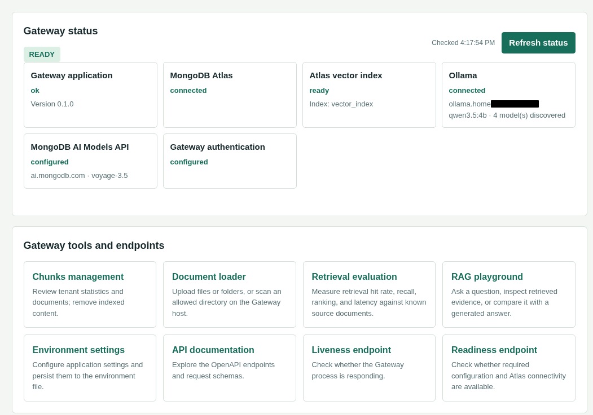

# Atlas RAG Gateway

> **Project status:** Atlas RAG Gateway is an independent personal project. It is not affiliated with, sponsored by, or endorsed by MongoDB, Inc.

A local-first Retrieval-Augmented Generation (RAG) service for local agents and chat UIs. It embeds document chunks and user questions with the configured model through MongoDB's AI Models API, retrieves matching chunks from MongoDB Atlas Vector Search, and sends the augmented conversation to a model served by local Ollama.



The project is built around a practical balance: keep answer generation on infrastructure you control, use a capable embedding model to find relevant knowledge, and connect existing clients such as Open WebUI and Hermes through familiar APIs. This can reduce dependence on hosted generation and make answers more grounded in your own documents, while keeping the embedding and vector-storage services managed. It is not a zero-cost or fully private stack; review the data boundary and ongoing service costs before use.

Read the [story behind the project](docs/project-story.md), the [beginner's guide in English](docs/beginner-guide-rag-gateway.md), or the [guide en français](docs/guide-debutant-rag-gateway.md) for the architecture, workflows, and user-facing tools.

> **Data boundary:** this is not a fully on-premises stack. Document text and query text are sent to the configured MongoDB AI model endpoint for embedding; chunks, metadata, and vectors are stored in MongoDB Atlas. Chat generation stays on your Ollama host. Check your organization's data classification, MongoDB AI model terms, Atlas region, retention, and network policy before ingesting real data.

## Architecture

Editable diagrams.net sources:

- [System architecture](docs/architecture.drawio)
- [Chat request sequence](docs/request-sequence.drawio)

Open either file with [diagrams.net](https://app.diagrams.net/) or a VS Code Draw.io integration to inspect and edit it.

## Stack

| Component | Role | Where it runs |
| --- | --- | --- |
| Python 3.11+ / FastAPI | Ingestion, retrieval, OpenAI-compatible chat endpoint | Your workstation or on-prem host |
| MongoDB AI Models API | Shared embedding model for documents and queries | MongoDB AI model endpoint |
| MongoDB Atlas Vector Search | Chunks, metadata, vectors, filtered nearest-neighbor search | MongoDB Atlas |
| Ollama | Local chat completion model | Already-running local/on-prem service |
| Open WebUI / Hermes | User and agent clients | Your local environment |

The default embedding model is `voyage-3.5`, requested through MongoDB's AI Models API, with 1024 dimensions. Verify model availability and dimensions for your MongoDB AI endpoint before creating the index. The model, `EMBEDDING_DIMENSIONS`, and Atlas index must agree exactly. Do not silently change only one of them.

The basic ingester handles UTF-8 `.txt` and `.md` files. An optional document loader adds recursive directory scanning, pre-ingestion extracted-text previews, and support for common document and image formats, using the configured Ollama OCR model for PDF pages and images. Retrieval considers the latest three user turns, uses tenant-filtered Atlas vector search with MongoDB Native Reranking enabled transparently by the MongoDB service, filters results below `RETRIEVAL_MIN_SCORE`, and adds evidence to the local model prompt. The Gateway does not issue a separate reranking request or expose reranker settings. Native Reranking is usage-billed, and MongoDB states its model inference runs on its infrastructure in a US region; review the service's current terms and data boundary. The retrieval evaluation workbench measures hit rate, recall, reciprocal rank, and latency against manually labeled question/document cases; it does not grade generated answers. Embedding requests to the configured MongoDB AI model endpoint use item and estimated-token batching with retries for transient errors. Scheduled sync, hybrid search, and document-level ACL filtering remain later phases.

## Build Plan

1. **Agree on the data boundary.** Identify allowed source folders and data classifications. Decide whether MongoDB AI models may receive source text and questions, which Atlas region is acceptable, and who can call the gateway. If policy requires all text to stay on-prem, replace the hosted embedding service before ingesting anything; Atlas and its AI model endpoint are cloud services in this design.
2. **Prepare Atlas.** Create or select a cluster in the intended region. Create a database user scoped to read/write on the gateway database, allow only the gateway's egress IP in Atlas Network Access, and use the Atlas-provided SRV connection string. Avoid broad `0.0.0.0/0` access for normal use.
3. **Prepare the MongoDB AI Models API.** Configure its API key and endpoint in `.env`. Set the model and its output dimension. Embedding model changes require re-embedding documents and recreating or migrating the vector index.
4. **Run the local service.** Configure `.env`, install the project in the Miniconda environment, check that Ollama serves the chosen model, then start FastAPI. Docker is optional packaging.
5. **Create the Atlas vector index.** In Atlas Data Explorer, open the configured database and collection, create a Vector Search index named `rag_chunks_vector`, and use the JSON in [`src/rag_gateway/infra_atlas-vector-index.json`](src/rag_gateway/infra_atlas-vector-index.json). It uses 1024-dimensional cosine similarity with scalar quantization and declares `tenant_id`, `document_id`, `embedding_model`, and `chunk_policy` as filter fields. Wait until Atlas reports the index ready before testing retrieval. The service does not update an existing managed index automatically.
6. **Ingest a small, non-sensitive corpus.** Start with a few Markdown/text files. Check ingestion counts, run retrieval, inspect scores and source text, then ask known-answer questions through chat. Confirm a question with no matching evidence is handled as unknown.
7. **Connect Open WebUI.** Add an OpenAI-compatible connection with base URL `http://localhost:8000/v1` when Open WebUI runs on the host. If Open WebUI runs in Docker, use `http://host.docker.internal:8000/v1` and ensure the gateway is reachable from that container. Set its API key to `GATEWAY_API_KEY` when using shared-key mode, or to a registered key when `API_KEY_REGISTRY` is enabled; select model `rag-local` and send the authorized tenant in `X-Tenant-ID`.
8. **Connect Hermes.** Configure its OpenAI-compatible provider/base URL as above, set the shared or tenant-registered key, and select `rag-local`. If your Hermes build does not support a custom OpenAI-compatible base URL, call `POST /v1/chat/completions` from its HTTP/API tool; keep the gateway key in the agent's secret store, not prompts or repository files.
9. **Evaluate before broad rollout.** Build representative questions with expected source documents. Record retrieval hit rate, answer correctness, citation correctness, latency, embedding spend, and Atlas cost. Adjust chunk size/overlap and `RETRIEVAL_TOP_K` using this set.
10. **Harden and operate.** Put the service behind authenticated TLS for remote clients, rotate keys, back up source documents, add structured request IDs and metrics, monitor Atlas and MongoDB AI model usage, and define deletion/re-index procedures. The optional key registry restricts keys to configured tenant IDs; it is not end-user identity or document-level ACL authorization.

For tenant-scoped API keys, set `API_KEY_REGISTRY` to a JSON object mapping each bearer key's SHA-256 hex digest to its allowed tenant IDs, for example `{"<sha256-hex>":["tenant-a"]}`. Hash the exact bearer secret with SHA-256 and use its lowercase hexadecimal digest as the key. Registered keys are restricted to their configured tenants. The raw `GATEWAY_API_KEY` remains an administrator credential for the document-loader, chunk-management, retrieval, evaluation, and chat tools, including when a registry is configured; on other routes with registry-only authentication, use a registered key. Ingestion uses the request body's `tenant_id`; retrieval, chat, and deletion use `X-Tenant-ID` (or `DEFAULT_TENANT_ID` if omitted). Leave the registry empty to retain shared-key behavior.

## Prerequisites

- Python 3.11 or newer, and Git. The included Conda environment uses Python 3.12.
- A running Ollama service and a model already pulled (`ollama list`). Set `OLLAMA_MODEL` to the exact installed model tag.
- A MongoDB Atlas cluster with Vector Search available, a database user, and a network rule for the gateway host.
- A MongoDB AI Models API key.
- Docker Engine and the Compose plugin only if using the optional container deployment.

## Install from source

Create and configure `.env` from `.env.example`, then install and run the gateway:

```bash
python -m venv .venv
source .venv/bin/activate
python -m pip install -e ".[loader]"
cp .env.example .env
python -m rag_gateway
```

Set `MONGODB_URI`, `MONGODB_API_KEY`, and `GATEWAY_API_KEY` (or configure
`API_KEY_REGISTRY`) in `.env` before using the API. On Windows PowerShell, activate
the environment with `.venv\Scripts\Activate.ps1`; the same install command applies.
The Conda workflow below is an alternative.

## Linux Setup (Miniconda)

From the repository root in Bash:

```bash
conda env create -f environment.yml
conda activate atlas-rag-gateway
cp .env.example .env
chmod 600 .env
${EDITOR:-nano} .env
ollama list
python -m rag_gateway
```

In `.env`, set `MONGODB_URI`, `MONGODB_API_KEY`, and one authentication mode: `GATEWAY_API_KEY` for shared-key mode, or a non-empty `API_KEY_REGISTRY` for tenant-scoped keys. See [Generate and use gateway keys](#generate-and-use-gateway-keys) below. Set `OLLAMA_MODEL` to an installed Ollama tag. For native Linux execution, the default `OLLAMA_BASE_URL=http://localhost:11434/v1` is suitable when Ollama listens on its normal local port.

Native startup reads `GATEWAY_BIND_ADDRESS` and `GATEWAY_PORT` from `.env`; use `python -m rag_gateway` or the installed `rag-gateway` command so those values are applied. Direct `uvicorn rag_gateway.main:app` starts Uvicorn with its own bind defaults and does not read these Gateway settings. In Docker Compose, the same variables configure the host-side published address and port; the container continues listening on `0.0.0.0:8000`.

The Conda environment installs the project and its development tools from `pyproject.toml`. To apply later dependency changes, run `conda env update -f environment.yml --prune` while the environment is active.

Open `http://127.0.0.1:8000/docs` for the local API explorer. `/healthz` is a liveness check; `/readyz` checks required configuration and Atlas connectivity. Loopback binding keeps the gateway accessible only to local host processes by default. If a client runs in a container, use the Docker networking guidance below and restrict any broader host binding with the host firewall.

### Generate and use gateway keys

For shared-key mode, generate a fresh, URL-safe secret with Python:

```bash
python -c 'import secrets; print(secrets.token_urlsafe(32))'
```

Copy the generated output into your private `.env` file as `GATEWAY_API_KEY`. Do not commit `.env`, paste the key into source code, or share it in logs. The key is the bearer token itself; clients send the same raw secret in the HTTP header `Authorization: Bearer <secret>`. `YOUR_GATEWAY_API_KEY` in examples is only a placeholder, not a literal value to send.

For Bash, load the same value into the current shell before using the CLI or `curl`:

```bash
export GATEWAY_API_KEY="paste-the-generated-secret-here"
curl -H "Authorization: Bearer ${GATEWAY_API_KEY}" http://127.0.0.1:8000/v1/models
```

For PowerShell, use `$env:GATEWAY_API_KEY = 'paste-the-generated-secret-here'` and send the header with `curl.exe -H "Authorization: Bearer $env:GATEWAY_API_KEY" ...`. Do not include the word `Bearer` in the `.env` value; it belongs only in the HTTP header.

To use tenant-scoped keys instead, generate a separate raw secret the same way, then compute its SHA-256 hex digest without displaying the secret:

```bash
python -c 'import getpass, hashlib; print(hashlib.sha256(getpass.getpass("Bearer key: ").encode()).hexdigest())'
```

`API_KEY_REGISTRY` must be a JSON object with this structure:

```json
{
  "<lowercase SHA-256 hex digest of one raw bearer key>": ["tenant-a", "tenant-b"],
  "<lowercase SHA-256 hex digest of another raw bearer key>": ["default"]
}
```

Each property name is the 64-character lowercase hexadecimal SHA-256 digest of a raw bearer-key secret; each value is a JSON array of tenant ID strings that this key may access. Generate the digest from the exact raw secret using `hashlib.sha256(raw_secret.encode()).hexdigest()`. Do not put raw API secrets in `API_KEY_REGISTRY`, and give the client the raw secret, never the digest. A non-empty registry replaces shared-key authentication for normal API routes: only matching registered secrets are accepted and every requested tenant must be in that key's array. Browser management tools (`/tools/document-loader` and `/tools/chunks`) additionally accept `GATEWAY_API_KEY` as an administrator key with access to all tenants; registry keys remain tenant-scoped. The environment settings editor always requires `GATEWAY_API_KEY`. Ingestion uses the tenant in its JSON body; retrieval, chat, and chunk management use `X-Tenant-ID` or a `tenant_id` parameter. An empty registry retains shared-key authentication via `GATEWAY_API_KEY`. Keep `GATEWAY_API_KEY` configured as the key used by local ingestion scripts.

### Configure Atlas Vector Search

Atlas must have a running cluster with Vector Search available, a database user with `readWrite` access to the gateway database, and a Network Access rule allowing the gateway host's outbound IP. Do not use `0.0.0.0/0` for routine deployments. Put the Atlas SRV connection string in `.env` as `MONGODB_URI`; keep its username/password private. The default database and collection are `rag_gateway.chunks`, configurable with `MONGODB_DATABASE` and `MONGODB_COLLECTION`.

Create the collection in Atlas Data Explorer first, or start the gateway once after configuring `MONGODB_URI` so it creates the collection and ordinary `{tenant_id, document_id}` index. Then create the managed Vector Search index:

1. In Atlas Data Explorer, select the configured database and collection, then open **Search & Vector Search** and choose **Create Search Index** / **Vector Search**.
2. When Atlas asks how vectors will be created, choose **Bring your own embeddings**. This application generates vectors through the configured MongoDB AI Models API and stores them in the `embedding` field; do not choose **Automated Embedding**, which asks Atlas to generate/manage embeddings for text fields instead.
3. Choose the JSON editor and paste the contents of [`src/rag_gateway/infra_atlas-vector-index.json`](src/rag_gateway/infra_atlas-vector-index.json). The file uses Atlas's index-definition JSON shape with a top-level `fields` array; set the index name separately in Atlas. The duplicate deployment copy is [`infra/atlas-vector-index.json`](infra/atlas-vector-index.json); both definitions must stay aligned.
4. Set the index name to `rag_chunks_vector`, matching `ATLAS_VECTOR_INDEX` in `.env`. The definition uses the `embedding` field with 1024 dimensions and cosine similarity, plus `tenant_id`, `document_id`, `embedding_model`, and `chunk_policy` as filter fields.
5. Create/save the index and wait until Atlas reports **READY**. Vector retrieval will not work while it is building or if the filter fields are missing. The service does not create or update this managed index on startup.

The dimensions in the index must match the configured embedding model output and `EMBEDDING_DIMENSIONS`. If you change the model or dimensions later, re-embed the corpus and create/migrate the index deliberately; editing the JSON file alone does not change an index already deployed in Atlas. The default score cutoff is `0.72`; calibrate `RETRIEVAL_MIN_SCORE` against representative queries.

### Ingest local files

Put `.txt` or `.md` files in a directory, then run in another shell with the Conda environment active:

```bash
export GATEWAY_API_KEY="your-local-key"
python scripts/ingest_folder.py ./sample-docs --tenant default
```

The script sends file contents to the local gateway, which sends text to the configured MongoDB AI model endpoint for embeddings. Document IDs are relative paths; rerunning updates those documents. Embedding requests are capped by `EMBEDDING_BATCH_SIZE` and an estimated 100,000-token batch budget; transient transport errors and HTTP 408, 429, 500, 502, 503, and 504 responses are retried up to five attempts with backoff. Token counts are estimates, not tokenizer-exact limits. The API also accepts one document as JSON at `POST /v1/ingest`.

### Ollama document loader

The optional loader extracts text locally where possible and sends image content to the configured Ollama model for OCR. The default image OCR model is `glm-ocr:latest`: PDF pages are rendered locally and passed to Ollama; PNG and JPEG files are sent directly to Ollama, while TIFF/BMP files are converted locally first. Pillow is only needed for TIFF/BMP conversion, not for PNG/JPEG OCR. Text, Markdown, CSV, HTML, JSON, XML/YAML, DOCX, XLSX/XLSM, and PPTX use local text/table extractors. Embedded images inside DOCX/PPTX are not parsed in this version. Supported image extensions are PNG, JPEG, TIFF, and BMP.

Install the optional format dependencies and make sure the configured parser model is available through the local Ollama server:

```bash
python -m pip install -e ".[dev,loader]"
```

When the web loader is enabled, application startup logs the models discovered from Ollama and warns if the configured parser model is not installed. The loader also checks that the selected model is listed before starting a job. Verify that the installed model can execute image prompts before loading a large corpus.

Run the CLI against a local directory. It scans recursively by default, prints parsing/ingestion progress per file, continues after individual failures, and prints an overall summary:

```bash
export GATEWAY_API_KEY="your-local-key"
python scripts/document_loader.py ./sample-docs --tenant default \
  --include .pdf,.txt,.md,.docx,.xlsx,.pptx,.csv,.html \
  --exclude .log
```

For a browser UI, configure and restart the gateway with an explicit allowlist of host directories. The UI is disabled by default because it can read files from the gateway host:

```dotenv
DOCUMENT_LOADER_ENABLED=true
DOCUMENT_LOADER_ROOTS=["/data/policies","/data/handbooks"]
DOCUMENT_PARSER_MODEL=glm-ocr:latest
DOCUMENT_PARSER_TIMEOUT_SECONDS=300
```

Open `http://127.0.0.1:8000/tools/document-loader`, enter a gateway bearer token, and select the Ollama parser model. Upload files or entire folders by choosing them or dragging them into the drop area; uploaded folders retain their relative paths as document IDs. The page also retains the option to scan an allowed directory already on the Gateway host. Browser uploads are limited to 500 files, 50 MiB per file, and 200 MiB total per job. The page polls job status and displays the current file, eligible/processed/succeeded/failed counts, skipped files, and recent events. Jobs run in the Gateway process and their status is kept in memory; a process restart loses active and historical job state. The API limits active jobs with `DOCUMENT_LOADER_MAX_ACTIVE_JOBS` (default `2`), and extracted text must fit within `MAX_DOCUMENT_CHARS`.

### Smoke-test retrieval and chat

The examples use the `GATEWAY_API_KEY` environment variable set above. If you use `API_KEY_REGISTRY`, set it to the raw secret registered for the requested tenant.

When `API_KEY_REGISTRY` is enabled, use the raw secret corresponding to a registered hash and ensure the requested tenant (including `default` in these examples) is in that key's allowlist.

```bash
curl -H "Authorization: Bearer ${GATEWAY_API_KEY}" http://127.0.0.1:8000/v1/models
curl -X POST http://127.0.0.1:8000/v1/retrieve -H "Authorization: Bearer ${GATEWAY_API_KEY}" -H "Content-Type: application/json" -H "X-Tenant-ID: default" -d '{"query":"What does the policy say about retention?"}'
curl -X POST http://127.0.0.1:8000/v1/chat/completions -H "Authorization: Bearer ${GATEWAY_API_KEY}" -H "Content-Type: application/json" -H "X-Tenant-ID: default" -d '{"model":"rag-local","messages":[{"role":"user","content":"What does the policy say about retention?"}],"stream":false}'
```

Chat responses include source metadata, including streaming responses in an initial SSE chunk with a non-standard `sources` extension that clients may ignore. The model is instructed to cite retrieved evidence inline as `[S1]`, `[S2]`. Retrieved text is treated as untrusted evidence: prompt-fence strings and citation-shaped markers in source text are sanitized before prompt construction, and each prompt uses a random evidence delimiter.

## Docker (Optional)

Create and configure `.env` as above, then run:

```bash
docker compose up --build -d
docker compose logs -f rag-gateway
```

Compose publishes the gateway on `127.0.0.1:8000` by default and points its container to Ollama at `host.docker.internal:11434` using Docker's `host-gateway` mapping. Set `OLLAMA_DOCKER_BASE_URL` in `.env` if Ollama is reachable at a different URL from inside the container; this is separate from the native `OLLAMA_BASE_URL`. Atlas Network Access must allow the host/container's public egress IP. If Open WebUI runs in a different container, add `host.docker.internal:host-gateway` to its `extra_hosts` and use `http://host.docker.internal:8000/v1`. If host-gateway routing is unavailable, place both containers on one Docker network and address the gateway by its Compose service name. The gateway container may need Ollama to listen on a Docker-reachable host interface; if so, configure Ollama's `OLLAMA_HOST` and firewall to allow only the required Docker bridge. Do not expose either service broadly to the LAN.

The Docker image installs the `loader` optional dependencies so PDF and office documents can be parsed. Rebuild and recreate the container after changing the Dockerfile with `docker compose up --build -d`.

## API

All `/v1/*` endpoints require a bearer token. With an empty `API_KEY_REGISTRY`, it must match `GATEWAY_API_KEY`; with a non-empty registry, it must match a registered key hash.

For an OpenAI-compatible client, use `/v1` as the base URL and select `rag-local`. The gateway root is also available at `GET /v1`; `GET /v1/api/tags` returns an Ollama-compatible listing containing the gateway model for clients that use Ollama-style discovery. `GET /v1/api/ps` returns an empty `models` list because the gateway does not track model residency, and `GET /v1/api/version` returns the gateway application version. Chat is supported through both OpenAI-compatible `POST /v1/chat/completions` and Ollama-compatible `POST /v1/api/chat`; both routes perform the same RAG retrieval before generation.

| Method and path | Purpose |
| --- | --- |
| `GET /healthz` | Liveness probe |
| `GET /readyz` | Configuration and Atlas readiness |
| `GET /metrics` | Authenticated Prometheus-format request counts and cumulative latency |
| `GET /v1/document-loader/jobs?limit=25` | List recent ingestion jobs for authorized tenants |
| `GET /v1/document-loader/jobs/{job_id}` | Get durable ingestion job progress and file outcomes |
| `POST /v1/document-loader/jobs/{job_id}/cancel` | Cancel a currently running ingestion job |
| `POST /v1/document-loader/jobs/{job_id}/retry` | Retry failed files from an allowed directory-based job |
| `DELETE /v1/document-loader/jobs` | Clear completed job history for authorized tenant(s) |
| `GET /v1/status` | Safe global status for the welcome page; reports Atlas, vector index, Ollama, and MongoDB AI API status without credentials |
| `GET /tools/evaluation` | Browser workbench for retrieval metrics against manually labeled questions |
| `GET /tools/playground` | Try retrieval-only queries or chat grounded in retrieved sources |
| `POST /v1/evaluations/retrieval` | Run retrieval hit-rate, recall, ranking, and latency evaluation cases |
| `GET /v1/evaluations/retrieval?tenant_id=...` | List saved retrieval evaluation runs |
| `GET /v1/evaluations/retrieval/{run_id}` | Get a saved evaluation run and its case details |
| `GET /v1/evaluations/retrieval/{run_id}/compare/{baseline_id}` | Compare runs using the same tenant, top K, and labeled cases |
| `POST /v1/document-loader/preview` | Extract and preview one uploaded document without ingesting it |
| `GET /v1/admin/environment` | Admin-only redacted settings snapshot |
| `PUT /v1/admin/environment` | Admin-only persistent settings update |
| `POST /v1/admin/environment/gateway-api-key` | Admin-only generation of a new key, returned once and not persisted until saved |
| `GET /v1` | Authenticated gateway status and compatibility routes |
| `GET /v1/models` | Advertise the configured gateway model |
| `GET /v1/api/tags` | Ollama-compatible model discovery for clients that append `/api/tags` to the configured base URL |
| `GET /v1/api/ps` | Ollama-compatible running-model status; empty because the gateway does not expose backend model process state |
| `GET /v1/api/version` | Ollama-compatible version response using the gateway application version |
| `POST /v1/api/chat` | Ollama-compatible chat route adapted to the gateway's RAG chat flow; optional `top_k` must be between 1 and 50 |
| `POST /v1/ingest` | Chunk, embed, and upsert a document |
| `DELETE /v1/documents/{document_id}` | Delete a document for `X-Tenant-ID` |
| `GET /v1/chunks/tenants` | List chunk and document statistics for authorized tenants |
| `GET /v1/chunks/documents?tenant_id=...` | List source documents and chunk counts for a tenant |
| `DELETE /v1/chunks/documents/{document_id}?tenant_id=...` | Delete one document's chunks |
| `DELETE /v1/chunks/tenant?tenant_id=...` | Delete every document and chunk in a tenant |
| `POST /v1/retrieve` | Inspect top-k chunks for a query; optional `top_k` must be between 1 and 50 |
| `POST /v1/chat/completions` | Retrieve evidence, augment prompt, and call local Ollama; optional `top_k` must be between 1 and 50 |

The root URL (`/`) is a welcome page with links to the tools and API docs, plus a live global status check for Atlas connectivity, the configured vector index, Ollama model availability, MongoDB AI API configuration, and gateway authentication. `/tools/document-loader` accepts browser uploads by file/folder selection or drag-and-drop, as well as scanning allowed Gateway-host directories. Preview one selected upload before ingestion; extraction is temporary and does not send text to embeddings or Atlas, though PDF/image OCR sends rendered image data to the configured Ollama service. Open `/tools/evaluation` to submit up to 100 question cases with expected document IDs; metrics report hit rate, recall, mean reciprocal rank, and latency for retrieval only, not generated-answer quality. The API accepts a registered tenant key for its allowed tenant(s), or `GATEWAY_API_KEY` as an administrator key when `API_KEY_REGISTRY` is enabled. Open `/tools/playground` to compare retrieval-only results with RAG chat, adjust the number of sources (1–50), and inspect source chunks or citations. Open `/tools/chunks` to review per-tenant statistics and documents, delete individual documents, or clear a tenant. The management pages use bearer authentication; registered keys remain limited to their authorized tenants. Tenant-wide deletion requires typing the tenant ID to confirm.

Ingestion jobs and retrieval evaluation runs are stored in the local SQLite database configured by `OPERATIONS_DB_PATH` (default `data/rag_gateway_operations.sqlite3`). Keep this file on persistent storage and include it in the Gateway's backup/retention policy. The database contains ingestion metadata and evaluation queries/results, so protect it accordingly. Jobs active during shutdown are marked `interrupted`; they are not resumed automatically. Failed files from directory-based jobs can be retried while the source files remain available under `DOCUMENT_LOADER_ROOTS`; browser-upload sources are temporary and must be uploaded again. Clearing history removes terminal job records but never deletes active jobs or ingested Atlas content. Docker Compose stores this database in the `rag-gateway-data` named volume. Request logs include a validated/generated `X-Request-ID` and route/status/duration fields as JSON. The authenticated `/metrics` endpoint exposes process-local Prometheus counters; counters reset when the Gateway restarts and are not intended as durable billing records.

Example ingestion body:

```json
{
  "tenant_id": "default",
  "document_id": "handbook/leave-policy.md",
  "text": "Employees receive ...",
  "metadata": {"source": "handbook/leave-policy.md", "department": "people"}
}
```

Use the same tenant ID at ingestion and query time. `X-Tenant-ID` selects retrieval, chat, and deletion tenant and defaults to `DEFAULT_TENANT_ID`; ingestion sets `tenant_id` in its JSON body. Atlas applies the tenant filter. In shared-key mode callers can choose a tenant ID. With `API_KEY_REGISTRY`, the requested tenant must be in the authenticated key's allowlist. This is key-to-tenant authorization, not per-user identity or document-level ACL filtering.

## Configuration

See `.env.example`. Important settings:

The authenticated settings editor is available at `/tools/environment`. Enter the current `GATEWAY_API_KEY` in the page to load or save configuration; it can update all application settings, including credentials, without displaying existing secret values. **Generate new GATEWAY_API_KEY** creates a cryptographically random key and displays it once in the page so it can be copied. Copy it before saving: the server does not persist or return generated keys from the generation endpoint, and the settings page hides it again after save. Saving writes `.env` atomically with owner-only permissions; restart the Gateway and update clients to apply a rotated key. Blank secret inputs preserve the current value; use the corresponding Clear checkbox to remove an optional secret. Configure and use this page only over localhost or a trusted HTTPS connection. `GATEWAY_API_KEY` also acts as the administrator credential for the document-loader and chunks-management tools, even when `API_KEY_REGISTRY` is configured; registry-only keys remain scoped to their allowed tenants. By default, process environment variables take precedence over `.env`. The `infra/rag-gateway-compose.yaml` deployment opts into the reverse precedence so settings saved through the editor persist across container restarts; its environment variables act as defaults until settings are saved. Uvicorn command-line options such as `--host` and `--port` remain controlled by the launcher.

| Setting | Default | Meaning |
| --- | --- | --- |
| `MONGODB_URI` | empty | Atlas SRV connection URI |
| `MONGODB_API_MODEL_ENDPOINT` | `ai.mongodb.com` | MongoDB API model service hostname |
| `MONGODB_API_KEY` | empty | Key used for embedding requests and the startup model check |
| `VOYAGE_EMBEDDING_MODEL` | `voyage-3.5` | Model used for documents and queries |
| `EMBEDDING_DIMENSIONS` | `1024` | Must match model output and Atlas index |
| `OLLAMA_BASE_URL` | `http://localhost:11434/v1` | Local Ollama OpenAI-compatible API |
| `OLLAMA_MODEL` | `qwen2.5:7b` | Exact locally installed model tag |
| `CHUNK_SIZE` / `CHUNK_OVERLAP` | `1200` / `150` | Character-based chunking; tune with evaluation |
| `EMBEDDING_BATCH_SIZE` | `64` | Maximum texts in one embedding request (also constrained by the estimated token budget) |
| `RETRIEVAL_TOP_K` | `5` | Maximum retrieved chunks per request |
| `RETRIEVAL_MIN_SCORE` | `0.72` | Minimum Atlas vector score accepted as evidence; calibrate against an evaluation set |
| `API_KEY_REGISTRY` | `{}` | JSON map of SHA-256 bearer-key hashes to allowed tenant IDs; overrides the shared key when non-empty |
| `DOCUMENT_LOADER_ENABLED` | `false` | Enables the authenticated browser loader and its job APIs |
| `DOCUMENT_LOADER_ROOTS` | `[]` | JSON array of directories the browser loader is allowed to scan |
| `DOCUMENT_LOADER_MAX_ACTIVE_JOBS` | `2` | Maximum concurrent browser loader jobs |
| `OPERATIONS_DB_PATH` | `data/rag_gateway_operations.sqlite3` | SQLite file for durable ingestion and retrieval-evaluation history |
| `DOCUMENT_PARSER_MODEL` | `glm-ocr:latest` | Ollama model used to parse PDF pages and images |
| `DOCUMENT_PARSER_TIMEOUT_SECONDS` | `300` | Timeout for an Ollama parsing request |

On startup, the gateway logs Ollama model discovery and checks the configured chat/document-parser model tags. It also pings MongoDB Atlas, checks whether the configured `ATLAS_VECTOR_INDEX` exists and is queryable, and lists the distinct `tenant_id` values present in the configured collection. These diagnostics log the host and database/collection connection result without exposing URI credentials. When `MONGODB_API_KEY` is set, startup sends a small embeddings smoke request to `MONGODB_API_MODEL_ENDPOINT` using `VOYAGE_EMBEDDING_MODEL` and compares its returned vector size with `EMBEDDING_DIMENSIONS`. The smoke request uses the same MongoDB AI API endpoint and key used by ingestion, and may count toward API usage. Without `MONGODB_API_KEY`, the MongoDB AI API model check is logged as skipped, and embedding requests will fail with a configuration error.

Each stored chunk also records `embedding_model`, `embedding_dim`, `chunk_policy`, and a SHA-256 hash of its chunk text. These fields provide provenance and support future migrations; they do not yet enable automatic re-embedding, unchanged-file skipping, or document-level fingerprint checks.

## Verification

```bash
python -m pytest -q
ruff check src tests scripts
```

## Limitations and next improvements

- Chunking is character-based and does not preserve Markdown section structure. DOCX/PPTX extraction currently reads text and tables but not embedded images; the configured Ollama OCR model is used for PDF pages and standalone image files.
- This starter stores chunk text and vectors together in Atlas. Atlas and its AI model endpoint are cloud services; do not ingest restricted content without approval.
- Tenant-scoped API keys are optional and configured statically through `API_KEY_REGISTRY`. There is no user identity provider, dynamic tenant provisioning, or document-level ACL enforcement.
- Retrieval uses tenant-filtered vector search with MongoDB Native Reranking enabled by the managed service. Hybrid full-text/vector retrieval, additional metadata/ACL filters, and query rewriting are not implemented; evaluate them against a labeled test set before adding them.
- Embedding model, dimensions, chunking policy, and per-chunk content hash are recorded, but there is no automated re-embedding migration, incremental ingestion manifest, or deleted-file synchronization.
- Chunking still normalizes text into character-based chunks and does not preserve Markdown section structure. Chat and retrieve request bodies also use manual rather than complete typed-schema validation.
- The retrieval evaluation workbench measures retrieval against manually labeled document IDs. It does not evaluate answer correctness, citation quality, or model behavior; a labeled answer-evaluation harness and configurable Gateway-managed reranking remain future work. MongoDB Native Reranking is managed outside the Gateway and may incur usage-based charges.

## References

- [MongoDB Atlas Vector Search](https://www.mongodb.com/docs/atlas/atlas-vector-search/)
- [MongoDB Vector Search query stage](https://www.mongodb.com/docs/atlas/atlas-vector-search/vector-search-stage/)
- [Ollama OpenAI compatibility](https://github.com/ollama/ollama/blob/main/docs/openai.md)
- [Open WebUI OpenAI-compatible connections](https://docs.openwebui.com/getting-started/api-endpoints/)
- [FastAPI deployment](https://fastapi.tiangolo.com/deployment/)

## License

This project is distributed under the [MIT License](LICENSE).
