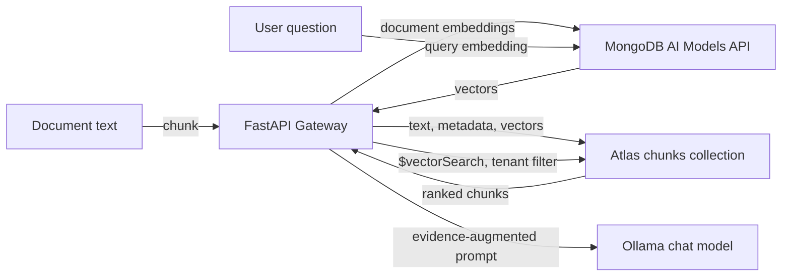

# MongoDB Atlas: data flow and usage

This guide describes how Atlas is used by Atlas RAG Gateway: how source text becomes
stored chunks and embeddings, how the Vector Search index is defined, and how the
gateway uses Atlas across ingestion and query requests.

## At a glance



Atlas is the durable vector store. The configured MongoDB AI Models API generates
embeddings; the gateway does not calculate vectors locally. The chat model is served
by Ollama, not by Atlas. Both source text and user queries are sent to the configured
embedding endpoint, while stored chunk text, metadata, and vectors reside in Atlas.
Review your data classification, endpoint terms, Atlas region, retention, and network
policy before using sensitive content.

## Chunk creation and storage

### From source document to chunks

The normal ingestion endpoint accepts one document as JSON:

```http
POST /v1/ingest
Authorization: Bearer <gateway-key>
Content-Type: application/json
```

```json
{
  "tenant_id": "default",
  "document_id": "handbook/leave-policy.md",
  "text": "The complete extracted document text...",
  "metadata": {
    "source": "handbook/leave-policy.md",
    "department": "people"
  }
}
```

`document_id` and `text` are required. `tenant_id` defaults to `default`, and
`metadata` defaults to an empty object. Extra top-level request fields are rejected.
The maximum accepted source text length is controlled by `MAX_DOCUMENT_CHARS`
(default: 1,000,000 characters).

`chunk_text` first collapses all whitespace runs to a single space. It then slices
the normalized text into character-based chunks, preferring a space boundary before
the configured end when one is available. The default `CHUNK_SIZE=1200` and
`CHUNK_OVERLAP=150` mean adjacent chunks share approximately 150 characters. This
is character-based chunking: it does not count tokens or preserve Markdown sections.
Whitespace normalization also means original line breaks are not retained.

The same process is used by direct API ingestion and the optional document loader.
The loader extracts text from supported files first, uses the relative file path as
the document ID, and adds source/loader/parser information to metadata.

### Atlas collection and document shape

The default namespace is database `rag_gateway`, collection `chunks`. Configure
these with `MONGODB_DATABASE` and `MONGODB_COLLECTION`. Each chunk is one MongoDB
document with this shape:

```json
{
  "_id": "<sha256 of tenant, document, and chunk index>",
  "tenant_id": "default",
  "document_id": "handbook/leave-policy.md",
  "chunk_index": 0,
  "text": "One normalized passage from the source...",
  "metadata": {
    "source": "handbook/leave-policy.md",
    "department": "people"
  },
  "embedding": ["<1024 floating-point values>"],
  "embedding_model": "voyage-3.5",
  "embedding_dim": 1024,
  "chunk_policy": "char-v1:1200:150",
  "content_sha256": "<sha256 of this chunk text>",
  "updated_at": "<UTC timestamp>"
}
```

The values above illustrate defaults; vectors and hashes are abbreviated. `_id` is
deterministic for `(tenant_id, document_id, chunk_index)`. Re-ingesting a document
therefore replaces/upserts its chunks at those positions. After writing, the gateway
deletes any old chunks for that same tenant and document whose index is beyond the
new chunk count. A document that now produces no chunks removes its prior chunks.
Different tenants may use the same document ID without overwriting each other.

`chunk_policy` records the chunking version and configured size/overlap, and
`content_sha256` records the chunk text hash. These fields help identify what was
stored; the gateway does not currently use them to perform incremental updates or
automatically re-embed old documents. Changing the embedding model, dimensions, or
chunking settings requires an intentional re-ingestion plan.

At startup the gateway creates a regular MongoDB compound index on
`(tenant_id, document_id)`, used by document-oriented operations. This is separate
from the Atlas Vector Search index described below.

## Embeddings

The configured embedding service is called at
`{MONGODB_API_MODEL_ENDPOINT}/v1/embeddings` with a bearer API key. The default
endpoint host is `ai.mongodb.com`; the default model is `voyage-3.5`.

For document ingestion, the gateway sends each chunk with `input_type: "document"`.
For retrieval, it embeds the query with `input_type: "query"`. Both uses must have
compatible vector dimensions and use the same embedding model configuration.

Embedding inputs are sent in batches. `EMBEDDING_BATCH_SIZE` defaults to 64 and is
capped at 128; a separate estimated token-budget guard limits each request to about
100,000 tokens. The gateway retries transient transport failures and selected HTTP
statuses such as 429 and 5xx responses. It checks that the API returns one vector
per input and that every vector length matches `EMBEDDING_DIMENSIONS` (default:
1024). An embedding dimension mismatch fails ingestion/retrieval rather than
silently storing an incompatible vector.

Each chunk's vector is stored in the `embedding` field alongside its text and
metadata. This lets Atlas Vector Search return the evidence passage and its source
information from the same collection. The query vector is transient: it is used in
the search request and is not written to the collection.

## Atlas Vector Search index

Create the Search index in Atlas for the configured database and collection. The
index name must equal `ATLAS_VECTOR_INDEX` (default: `rag_chunks_vector`). The
repository's index definition is
[`src/rag_gateway/infra_atlas-vector-index.json`](../src/rag_gateway/infra_atlas-vector-index.json):

```json
{
  "fields": [
    {
      "type": "vector",
      "path": "embedding",
      "numDimensions": 1024,
      "similarity": "cosine",
      "quantization": "scalar"
    },
    { "type": "filter", "path": "tenant_id" },
    { "type": "filter", "path": "document_id" },
    { "type": "filter", "path": "embedding_model" },
    { "type": "filter", "path": "chunk_policy" }
  ]
}
```

The vector's `numDimensions` must agree with the selected model's output and
`EMBEDDING_DIMENSIONS`. If any of these differ, vector writes or searches can fail.
The filter fields declare which stored values can be used as Atlas Search filters.
The current gateway search applies `tenant_id`; the other filter fields are stored
for identification/future filtering but are not currently included in its search
filter.

The gateway checks the configured index name and whether it is queryable during
startup/status checks. It does not create, update, or migrate the Vector Search
index. Create it in Atlas and wait until it is ready before relying on retrieval.

## Retrieval request and search behavior

To inspect retrieval without generating a chat response:

```http
POST /v1/retrieve
Authorization: Bearer <gateway-key>
X-Tenant-ID: default
Content-Type: application/json
```

```json
{
  "query": "How many days of leave are available?",
  "top_k": 5
}
```

`query` must be a non-empty string. `top_k` is optional and must be an integer from
1 to 50; when omitted, `RETRIEVAL_TOP_K` (default: 5) is used. The query is capped
at `MAX_QUERY_CHARS` (default: 8,000). `X-Tenant-ID` selects the tenant, falling
back to `DEFAULT_TENANT_ID` when omitted.

The gateway embeds the query using `input_type: "query"`, then sends an aggregation
to the configured collection. Its `$vectorSearch` stage uses:

- `index`: `ATLAS_VECTOR_INDEX`
- `path`: `embedding`
- `queryVector`: the newly generated query vector
- `filter`: `tenant_id` equals the selected tenant
- `limit`: the requested `top_k`
- `numCandidates`: the larger of `RETRIEVAL_NUM_CANDIDATES` (default: 100) and
  `top_k`

The results include the document ID, chunk index, text, metadata, and Atlas
`vectorSearchScore`. The gateway then discards candidates below
`RETRIEVAL_MIN_SCORE` (default: 0.72). As a result, the response may contain fewer
than `top_k` chunks, including none. The response shape is `{"data": [...]}`.

## How Atlas is used across the gateway

Atlas is shared by the gateway's ingestion and query features:

1. **Ingestion** — `POST /v1/ingest` and document-loader jobs extract or accept
   source text, chunk it, request document embeddings, then upsert chunks in Atlas.
2. **Retrieval-only** — `POST /v1/retrieve` embeds a query and returns qualifying
   Atlas matches for inspection and evaluation.
3. **RAG chat** — `POST /v1/chat/completions` and the Ollama-compatible
   `POST /v1/api/chat` retrieve evidence before forwarding an augmented prompt to
   Ollama. The gateway extracts text from up to the latest three user messages,
   attaches the retrieved text as untrusted evidence, and labels sources `[S1]`,
   `[S2]`, etc. Source identifiers and scores are returned with non-streaming
   responses; streaming responses emit a source event before generated tokens.
4. **Operations and management** — tenant/document listing and deletion operate on
   the same Atlas collection. The gateway's `/tools/chunks` interface uses these
   APIs; deleting a document or tenant removes its chunk records.
5. **Status checks** — startup pings Atlas, checks the configured vector index's
   existence/queryable state, and logs tenant IDs found in the collection.
   `GET /v1/status` exposes safe dependency state; `/readyz` checks required
   configuration and Atlas connectivity.

Protected data and tool routes require a bearer token; the safe global status route
is an exception. A shared `GATEWAY_API_KEY` permits the configured use cases; with
`API_KEY_REGISTRY`, a registered key is restricted to its allowed tenant IDs.
Ingestion sets `tenant_id` in its JSON body; retrieval, chat, and deletion use
`X-Tenant-ID` or a tenant query parameter depending on the route. The Atlas search
itself always filters by tenant. This is tenant isolation, not per-user identity or
document-level authorization.

The local SQLite database configured by `OPERATIONS_DB_PATH` holds loader job
history and retrieval-evaluation results; it is not the vector or chunk store.
MongoDB Atlas remains the source of truth for ingested chunks and embeddings.

## Configuration quick reference

| Setting | Default | Atlas/data-flow role |
| --- | --- | --- |
| `MONGODB_URI` | empty | Connects the gateway to Atlas |
| `MONGODB_DATABASE` | `rag_gateway` | Database containing the collection |
| `MONGODB_COLLECTION` | `chunks` | Collection containing one record per chunk |
| `ATLAS_VECTOR_INDEX` | `rag_chunks_vector` | Atlas Vector Search index name |
| `MONGODB_API_MODEL_ENDPOINT` | `ai.mongodb.com` | Embedding API endpoint host |
| `MONGODB_API_KEY` | empty | Bearer credential for embedding requests |
| `VOYAGE_EMBEDDING_MODEL` | `voyage-3.5` | Model used for document and query embeddings |
| `EMBEDDING_DIMENSIONS` | `1024` | Must match model output and vector index |
| `EMBEDDING_BATCH_SIZE` | `64` | Maximum embedding items per request (hard cap 128) |
| `CHUNK_SIZE` | `1200` | Target character length per chunk |
| `CHUNK_OVERLAP` | `150` | Character overlap between chunks |
| `RETRIEVAL_TOP_K` | `5` | Default vector result limit |
| `RETRIEVAL_NUM_CANDIDATES` | `100` | Minimum Atlas vector candidates requested |
| `RETRIEVAL_MIN_SCORE` | `0.72` | Minimum score accepted as evidence |
| `DEFAULT_TENANT_ID` | `default` | Tenant used when a query omits its tenant |

Keep the Atlas database user's privileges and network access limited to what the
gateway needs. Protect the MongoDB URI, embedding API key, and gateway bearer keys;
never commit populated secret values.
