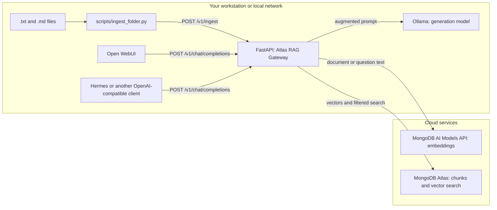
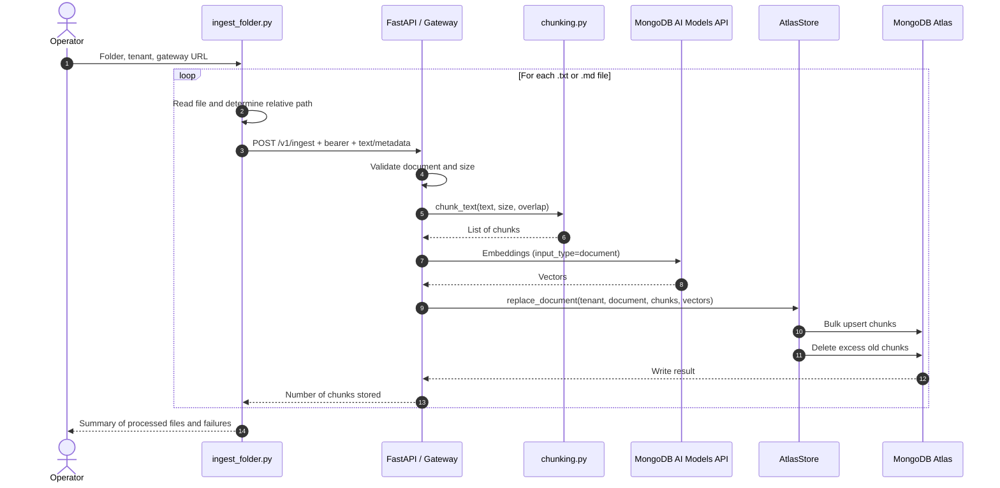
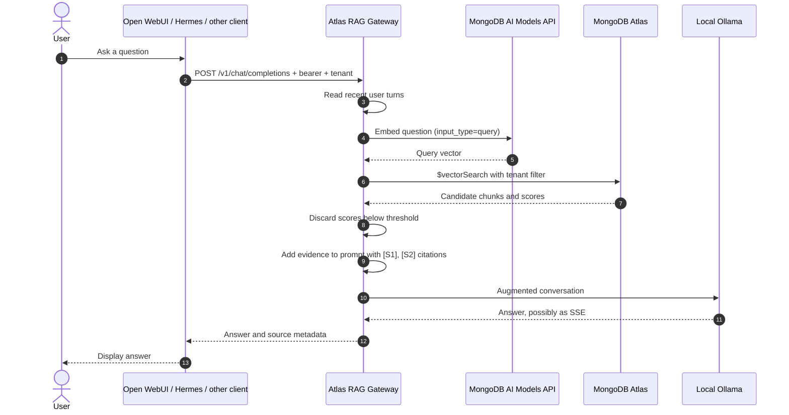

# Beginner's Guide: Atlas RAG Gateway

This guide explains how the application turns documents into answers with sources, where the main responsibilities live in the code, and how a client such as Open WebUI or Hermes uses it. The [French version](guide-debutant-rag-gateway.md) is also available.

## 1. The Basics

### RAG: retrieve before answering

A language model answers using what it learned during training and the text it receives in its conversation. It does not automatically know your organization's private documents, and it can produce a plausible but inaccurate answer.

RAG, short for *Retrieval-Augmented Generation*, adds a search step before generation:

1. Turn the question into a search representation.
2. Find relevant passages in a document collection.
3. Add those passages to the conversation as evidence.
4. Ask the model to answer from that evidence and say when evidence is missing.

The gateway orchestrates this sequence. The local model generates the answer; MongoDB Atlas retrieves passages; the MongoDB AI Models API converts text into search vectors.

### Embeddings: represent meaning as a vector

An embedding is a list of numbers calculated from text. Texts with similar meanings tend to produce nearby vectors. This makes it possible to find passages related to a question even when they do not use exactly the same words.

By default, this application requests the `voyage-3.5` embedding model through MongoDB's AI Models API to produce 1024-dimensional vectors. The same model is used for documents and questions, with distinct modes (`document` and `query`). The model's output dimensions, the `EMBEDDING_DIMENSIONS` setting, and the Atlas index must match.

Search uses vector proximity with cosine similarity. Atlas returns a score; the application discards results below `RETRIEVAL_MIN_SCORE`, which defaults to `0.72`. Treat this threshold as a starting point to evaluate against your own questions, not a universal guarantee of relevance.

### Chunking: split a document into passages

A whole document is often too long to use as one search result. *Chunking* splits it into shorter passages that can be retrieved separately.

The current code normalizes whitespace and line breaks, splits text into chunks of about `CHUNK_SIZE` characters, and keeps `CHUNK_OVERLAP` characters in common between neighboring chunks. Overlap reduces the chance of cutting an idea exactly at a chunk boundary.

Chunking is character-based, not token-based. It does not yet preserve Markdown structure such as headings, tables, or sections.

### Reranking: reorder search results

Vector search selects candidate passages. A *reranker* is an additional step that examines the question and each passage together, then reorders them by more precise relevance.

Reranking can improve the top results, but it usually adds a model call, latency, and cost. **This application does not currently rerank results.** It keeps Atlas's vector-search order and applies only a minimum score threshold. Hybrid text-plus-vector search is not implemented either.

## 2. At a Glance

The system has a local part and cloud services. Text sent to MongoDB's AI model endpoint for embeddings and chunks/vectors stored in Atlas leave the local environment. Answer generation stays on the configured Ollama service.



## 3. Code Structure

Application code is under `src/rag_gateway/`. Each module has one main responsibility.

| File | Responsibility |
| --- | --- |
| [main.py](../src/rag_gateway/main.py) | Starts FastAPI, checks authentication, exposes HTTP routes, and coordinates ingestion, retrieval, and generation. |
| [config.py](../src/rag_gateway/config.py) | Reads environment settings and validates values such as chunk size and overlap. |
| [models.py](../src/rag_gateway/models.py) | Defines the data expected by the ingestion API and its response. |
| [chunking.py](../src/rag_gateway/chunking.py) | Splits text into overlapping chunks. |
| [voyage.py](../src/rag_gateway/voyage.py) | Calls the configured MongoDB AI model endpoint, batches texts, and retries selected transient errors. |
| [store.py](../src/rag_gateway/store.py) | Writes, replaces, deletes, and searches chunks in MongoDB Atlas. |
| [rag.py](../src/rag_gateway/rag.py) | Creates question embeddings, assembles sources into the prompt, and extracts a query from chat history. |
| [document_loader.py](../src/rag_gateway/document_loader.py) | Scans directories, extracts multiple formats, calls the configured Ollama OCR model for pages/images, and reports progress. |
| [scripts/ingest_folder.py](../scripts/ingest_folder.py) | Scans a local folder and sends text/Markdown files to the API. |
| [scripts/document_loader.py](../scripts/document_loader.py) | CLI for the Ollama multi-format loader. |
| [infra/atlas-vector-index.json](../infra/atlas-vector-index.json) | Example Vector Search index definition to create in Atlas. |
| [compose.yaml](../compose.yaml) | Describes the optional Docker Compose deployment. |

### Main HTTP routes

The `/v1/*` routes require a bearer token. When `API_KEY_REGISTRY` is empty, the token must match `GATEWAY_API_KEY`. When the registry is configured, standard API requests require a registered key authorized for the requested tenant. Browser tools accept either the administrator `GATEWAY_API_KEY` (all tenants) or a registered key limited to its allowed tenant IDs.

| Route | Purpose |
| --- | --- |
| `GET /v1/models` | Advertises the model name exposed by the gateway, `rag-local` by default. |
| `GET /v1/status` | Reports safe status for Atlas, vector index, Ollama, MongoDB AI API, and Gateway authentication. |
| `GET /tools/playground` | Opens the browser playground to inspect retrieved passages or try RAG chat. |
| `GET /v1` | Returns authenticated gateway status and compatibility route information. |
| `GET /v1/api/tags` | Returns an Ollama-compatible list containing the gateway model for model discovery. |
| `GET /v1/api/ps` | Returns an Ollama-compatible running-model response with an empty list; backend model residency is not exposed. |
| `GET /v1/api/version` | Returns an Ollama-compatible version response containing the gateway application version. |
| `POST /v1/api/chat` | Accepts Ollama-style chat requests and adapts them to the same RAG chat flow. |
| `POST /v1/ingest` | Receives a document, chunks it, creates embeddings, and stores the chunks. |
| `DELETE /v1/documents/{document_id}` | Deletes a document for the selected tenant. |
| `GET /v1/chunks/tenants` | Lists document and chunk counts for tenants authorized to the API key. |
| `GET /v1/chunks/documents?tenant_id=...` | Lists source documents and chunk counts for a tenant. |
| `DELETE /v1/chunks/documents/{document_id}?tenant_id=...` | Deletes one source document. |
| `DELETE /v1/chunks/tenant?tenant_id=...` | Deletes all documents for a tenant. |
| `GET /v1/admin/environment` | Admin-only settings snapshot with secret values redacted. |
| `PUT /v1/admin/environment` | Admin-only persistent settings update. |
| `POST /v1/admin/environment/gateway-api-key` | Generates a replacement key, returned once and not persisted until saved. |
| `POST /v1/retrieve` | Searches for and returns passages matching a question, without generating an answer. |
| `POST /v1/chat/completions` | Retrieves evidence, augments the conversation, and sends the request to Ollama. |
| `GET /healthz` and `GET /readyz` | Check, respectively, whether the process responds and whether essential dependencies/configuration are available. |

The `/tools/chunks` page presents the same tenant-scoped statistics and document list. It supports deleting one document or clearing a tenant; tenant-wide deletion requires typing the tenant ID to confirm. Use a key authorized for the target tenant.

The root page (`/`) links to the tools and API documentation, and reports live status for Atlas, the vector index, Ollama, the MongoDB AI Models API, and Gateway authentication. `/tools/environment` edits all application settings and persists them to `.env`; configured secrets are redacted. Its **Generate new GATEWAY_API_KEY** action displays the cryptographically random key once for copying. Copy it before saving, then restart the Gateway and update clients. This administration page requires the current `GATEWAY_API_KEY` and should only be used on localhost or trusted HTTPS.

## 4. How a Document Is Ingested

Ingestion prepares data for future searches. It does not ask the chat model to write an answer yet. The original `scripts/ingest_folder.py` only handles UTF-8 `.txt` and `.md` files.

1. `scripts/ingest_folder.py` recursively scans a folder and selects UTF-8 `.txt` and `.md` files.
2. For each file, the script sends its text, relative path as `document_id`, a `tenant_id`, and metadata to `POST /v1/ingest`.
3. FastAPI validates the request body, checks the `MAX_DOCUMENT_CHARS` limit, and asks the chunking module to split the text.
4. `VoyageEmbedder` sends the chunks to the configured MongoDB AI model endpoint with `input_type=document`. Requests are limited by `EMBEDDING_BATCH_SIZE` and an estimated token budget; selected transient errors are retried with backoff.
5. `AtlasStore` stores each chunk with its vector, tenant, document, position, metadata, embedding model and dimensions, chunking policy, and a SHA-256 hash of the text.



Chunk IDs are deterministic for a tenant, document, and chunk position. Re-ingesting a file replaces its chunks and removes excess chunks if the new document is shorter. However, the script does not synchronize file deletions: if a file disappears from the folder, its document stays in Atlas until explicitly deleted.

Direct ingestion is also possible by calling `POST /v1/ingest` with a JSON body containing `tenant_id`, `document_id`, `text`, and optional `metadata`.

### Ollama multi-format loader

The loader shares the `document_loader.py` engine between a CLI and a local web interface. The default OCR model is `glm-ocr:latest`: PDF pages are rendered locally as images and sent through Ollama's local API; PNG/JPEG files go directly to Ollama, while TIFF/BMP files are converted locally first. Pillow is only needed for TIFF/BMP conversion, not PNG/JPEG OCR. Text, CSV, HTML, JSON, XML/YAML, DOCX, XLSX/XLSM, and PPTX use local extractors. For DOCX and PPTX, text and tables are extracted, but embedded images are not analyzed in this version. When the web loader is enabled, application startup logs Ollama's discovered models.

Install the optional libraries and check that the configured model is available in Ollama:

```bash
python -m pip install -e ".[dev,loader]"
```

NVIDIA's model card documents Transformers and vLLM, not an official Ollama distribution. Use a compatible local Ollama package/build and verify that it accepts image requests before processing a large corpus. The loader checks whether the configured tag appears in Ollama's model list, but its presence alone does not guarantee architecture compatibility.

Example CLI usage with explicit include and exclude filters:

```bash
export GATEWAY_API_KEY="your-local-key"
python scripts/document_loader.py ./sample-docs --tenant default \
    --include .pdf,.txt,.md,.docx,.xlsx,.pptx,.csv,.html \
    --exclude .log
```

Scanning is recursive by default. The CLI reports the current stage and file, continues after individual failures, and prints an overall summary at the end.

For the browser interface, explicitly allow the directories readable from the gateway host. The feature is disabled by default because it can access local files:

```dotenv
DOCUMENT_LOADER_ENABLED=true
DOCUMENT_LOADER_ROOTS=["/data/policies","/data/handbooks"]
DOCUMENT_PARSER_MODEL=glm-ocr:latest
```

After restarting the service, open `http://127.0.0.1:8000/tools/document-loader` and enter `GATEWAY_API_KEY` or a registered tenant key. You can choose or drag-and-drop files and folders from your browser device; folder-relative paths are retained as document IDs. The page also supports scanning gateway-host directories under `DOCUMENT_LOADER_ROOTS`. Uploads are limited to 500 files, 50 MiB per file, and 200 MiB total per job. The page shows the current file and job counts; job history is in memory and lost on restart. A registered key must authorize the selected tenant; the administrator key has access to all tenants. Extracted text must fit within `MAX_DOCUMENT_CHARS`.

### Experiment with uploaded documents in the playground

After the document-loader job reports successful ingestion, open `http://127.0.0.1:8000/tools/playground`, enter the same tenant ID and an authorized bearer key, and select **Retrieve sources only**. Ask a question about the uploaded content to see the matching chunks, document IDs, and retrieval scores. This is a way to test document extraction and retrieval without connecting or calling a chat LLM; no generated answer is requested in this mode.

Retrieval still needs the configured embedding service to vectorize the question and MongoDB Atlas with a ready vector-search index to search the ingested chunks. PDF/image OCR may also need the configured Ollama parser during ingestion. Chat mode (**Answer with RAG**) additionally calls the configured Ollama chat model. A document preview alone does not ingest it, so finish the loader job before testing it in the playground.

## 5. How a Question Becomes an Answer

A user types in Open WebUI or sends a request from Hermes. These applications do not query Atlas themselves; they call the gateway, which applies the same retrieval logic regardless of the client.

1. The client sends an OpenAI-compatible request to `POST /v1/chat/completions`, with `messages`, a bearer token, and optionally `X-Tenant-ID`.
2. The gateway extracts the last three non-empty user messages and combines them to provide some context for follow-up questions, such as “what about backups?”
3. The combined question is sent to the configured MongoDB AI model endpoint with `input_type=query` to obtain a vector.
4. Atlas searches for the nearest chunks within the authorized tenant. The pipeline applies `RETRIEVAL_TOP_K`, then keeps results whose score is greater than or equal to `RETRIEVAL_MIN_SCORE`.
5. The gateway adds the retrieved passages to a system message. Sources are labeled `[S1]`, `[S2]`, and so on. Document text is treated as untrusted data: selected prompt and citation markers are neutralized, and the evidence block uses a random delimiter.
6. The augmented request is sent to Ollama's local chat API.
7. The response is returned to the client. In non-streaming mode, sources are in the response's `sources` field. In streaming mode, they appear in an initial SSE event using a non-standard `sources` extension; some clients may ignore it.



If no source meets the threshold, the gateway tells the model that no relevant evidence was found and asks it not to invent source-backed facts. This reduces hallucination risk but does not, by itself, guarantee that every answer is correct.

## 6. Configure Open WebUI and Hermes

Both clients should connect to the **RAG gateway**, not directly to Ollama or the MongoDB AI Models API. The gateway retrieves tenant-filtered Atlas context, adds it to the conversation, and then calls Ollama.

### Before connecting a client

1. Start the gateway and confirm it is ready at `GET /readyz`.
2. Ingest a small set of documents using the intended tenant ID. Ingestion sets `tenant_id` in the request body; chat selects the same tenant using `X-Tenant-ID`.
3. Check that the selected API key is accepted:

   ```bash
   curl -H "Authorization: Bearer YOUR_GATEWAY_KEY" \
     http://127.0.0.1:8000/v1/models
   ```

4. Choose the gateway URL reachable from the client:
   - Same host as the gateway: `http://localhost:8000/v1`
   - Open WebUI in Docker, gateway on the host: `http://host.docker.internal:8000/v1` (and ensure the container can resolve/reach the host)
   - Both in Docker on the same network: use the gateway service name, for example `http://rag-gateway:8000/v1`

The client needs the gateway's raw bearer key as its API key. Do not use `MONGODB_API_KEY` here; that key is only for the gateway's embedding requests. With a non-empty `API_KEY_REGISTRY`, use a registered raw secret whose allowlist includes the tenant.

### Open WebUI

1. Open **Admin Panel → Settings → Connections** and add an **OpenAI-compatible** connection (the wording may vary by Open WebUI version).
2. Set the **API Base URL** to the gateway URL above, including the `/v1` suffix.
3. Set the **API key** to the raw `GATEWAY_API_KEY`, or to the registered raw key when using `API_KEY_REGISTRY`. Do not add the word `Bearer` to the key field.
4. Save the connection, refresh or fetch its models, and select **`rag-local`**. This is the gateway's public model ID; the gateway forwards generation to its configured `OLLAMA_MODEL`.
5. For a non-default tenant, configure the connection to send `X-Tenant-ID: your-tenant`. If the installed Open WebUI version does not expose custom headers for the connection, use the gateway's `DEFAULT_TENANT_ID` for that connection or another client that can set the header.
6. Ask a question whose answer is present in the ingested documents. Check for citations such as `[S1]`; if the answer does not use expected context, test the same request with `curl` to isolate client configuration from retrieval.

### Hermes

1. Add a provider/model that supports a custom **OpenAI-compatible API base URL**.
2. Set its base URL to the gateway URL above, including `/v1`, and its API key to the raw shared or registered gateway key (without a `Bearer ` prefix).
3. Set the model ID to **`rag-local`**. Do not configure Hermes to call the embedding model; embeddings and Atlas retrieval are performed by the gateway.
4. If the provider supports custom request headers, add `X-Tenant-ID: your-tenant` for a non-default tenant. The chosen key must be authorized for that tenant if `API_KEY_REGISTRY` is enabled.
5. If your Hermes version/provider cannot use a custom OpenAI-compatible base URL, call `POST /v1/chat/completions` through its HTTP/API tool instead. Send the gateway key in `Authorization: Bearer ...`, the tenant in `X-Tenant-ID`, and an OpenAI-compatible body, for example:

   ```json
   {
     "model": "rag-local",
     "messages": [{"role": "user", "content": "What does the handbook say about leave?"}],
     "stream": false
   }
   ```

Keep the gateway key in the client's secret store or environment, not in prompts, shared configuration, or source control. For streaming responses, source metadata is sent in an initial SSE event using a non-standard `sources` extension; a client may display the answer without showing that metadata.

All `/v1` compatibility routes require the same gateway bearer key. `GET /v1` reports gateway route information; `GET /v1/api/tags` supports model discovery for clients that append the Ollama-style `/api/tags` path; `GET /v1/api/ps` returns `{"models":[]}` because the gateway does not track backend model residency; and `GET /v1/api/version` returns the gateway application version. Chat works through either OpenAI-compatible `POST /v1/chat/completions` or Ollama-compatible `POST /v1/api/chat`; both use the same tenant-filtered retrieval and generation.

## 7. Configuration and Limitations

Settings are stored in `.env`; `.env.example` lists the names and starting values. The web loader is controlled by `DOCUMENT_LOADER_ENABLED`, `DOCUMENT_LOADER_ROOTS`, and `DOCUMENT_LOADER_MAX_ACTIVE_JOBS`. `DOCUMENT_PARSER_MODEL` and `DOCUMENT_PARSER_TIMEOUT_SECONDS` configure the Ollama parser. Other important settings include:

| Setting | Purpose |
| --- | --- |
| `MONGODB_URI`, `MONGODB_DATABASE`, `MONGODB_COLLECTION` | Atlas connection and location of stored chunks. |
| `MONGODB_API_MODEL_ENDPOINT` | MongoDB API model service hostname; defaults to `ai.mongodb.com`. |
| `MONGODB_API_KEY` | Required for embedding requests; also used by the startup model check. |
| `ATLAS_VECTOR_INDEX` | Name of the Vector Search index already created in Atlas. |
| `MONGODB_API_KEY`, `VOYAGE_EMBEDDING_MODEL`, `EMBEDDING_DIMENSIONS` | MongoDB AI embedding service and vector format. |
| `GATEWAY_API_KEY` or `API_KEY_REGISTRY` | Shared authentication or static key-to-tenant authorization. |
| `OLLAMA_BASE_URL`, `OLLAMA_MODEL` | Local generation service address and model. Compose overrides `OLLAMA_BASE_URL` in the container to reach the host. |
| `CHUNK_SIZE`, `CHUNK_OVERLAP` | Character-based document chunking. |
| `EMBEDDING_BATCH_SIZE` | Maximum texts per MongoDB AI model request, in addition to the estimated token budget. |
| `RETRIEVAL_TOP_K`, `RETRIEVAL_MIN_SCORE` | Maximum result count and minimum accepted score. |

`API_KEY_REGISTRY` is a JSON object whose keys are lowercase SHA-256 hex digests of raw bearer secrets and whose values are arrays of tenant ID strings. Example:

```json
{
  "<sha256-hex-of-client-secret>": ["default", "tenant-a"],
  "<sha256-hex-of-another-secret>": ["tenant-b"]
}
```

Compute each property name as `hashlib.sha256(raw_secret.encode()).hexdigest()`. Store only the digest in the registry and give each client its raw secret. With a non-empty registry, standard API authentication uses registered keys only: each can access only its listed tenants, and requested tenant IDs must match. Browser management tools additionally accept `GATEWAY_API_KEY` as a full-access administrator key; registry keys remain scoped. With an empty registry, API requests use `GATEWAY_API_KEY`. The environment editor requires `GATEWAY_API_KEY`; registry-scoped client keys cannot administer settings.

Embeddings and storage are cloud services in this architecture: source text and questions are sent to the configured MongoDB AI model endpoint, while chunks and their vectors are stored in Atlas. Check your organization's data classification and policies before using real documents.

At startup, the gateway logs the Ollama models it discovers, pings Atlas without exposing URI credentials, checks whether the configured Atlas Vector Search index exists and is queryable, and lists the distinct tenant IDs found in the collection. If `MONGODB_API_KEY` is configured, it also sends a small model-check embedding request to the MongoDB AI API endpoint; this request may count toward API usage. Otherwise that check is logged as skipped. Document ingestion and query embedding use the same endpoint and key.

The application stores embedding and chunk provenance, but cannot yet automatically migrate to a new model, skip unchanged files, or synchronize files removed from the source folder. It also has no reranker, hybrid search, evaluation set, Prometheus metrics, or document-level ACL filtering. Evaluate the score threshold and chunking settings with representative questions before a broad rollout.

## 8. Quick Start

After installing dependencies and configuring `.env`, start the API with:

```bash
python -m rag_gateway
```

Native startup reads `GATEWAY_BIND_ADDRESS` and `GATEWAY_PORT` from `.env`; use `python -m rag_gateway` (or `rag-gateway`) instead of launching the ASGI app directly with Uvicorn. In Docker Compose, these values configure the host-side published address and port; the container listens on `0.0.0.0:8000`.

Before the first search, MongoDB Atlas must be reachable, the configured Vector Search index must be `READY`, `MONGODB_API_KEY` must be configured, and Ollama must serve the selected chat model. See the [project README](../README.md) for platform-specific installation instructions.

Run the repository's automated tests with:

```bash
python -m pytest -q
```
