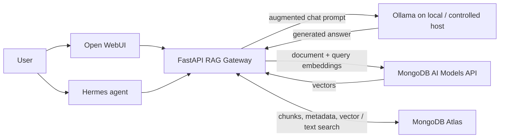
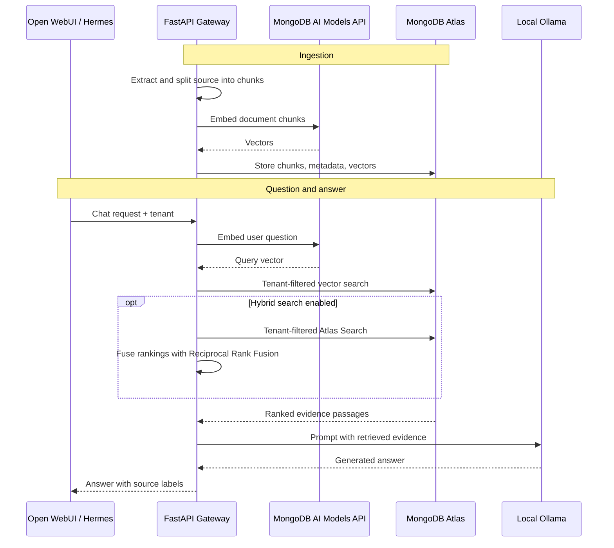
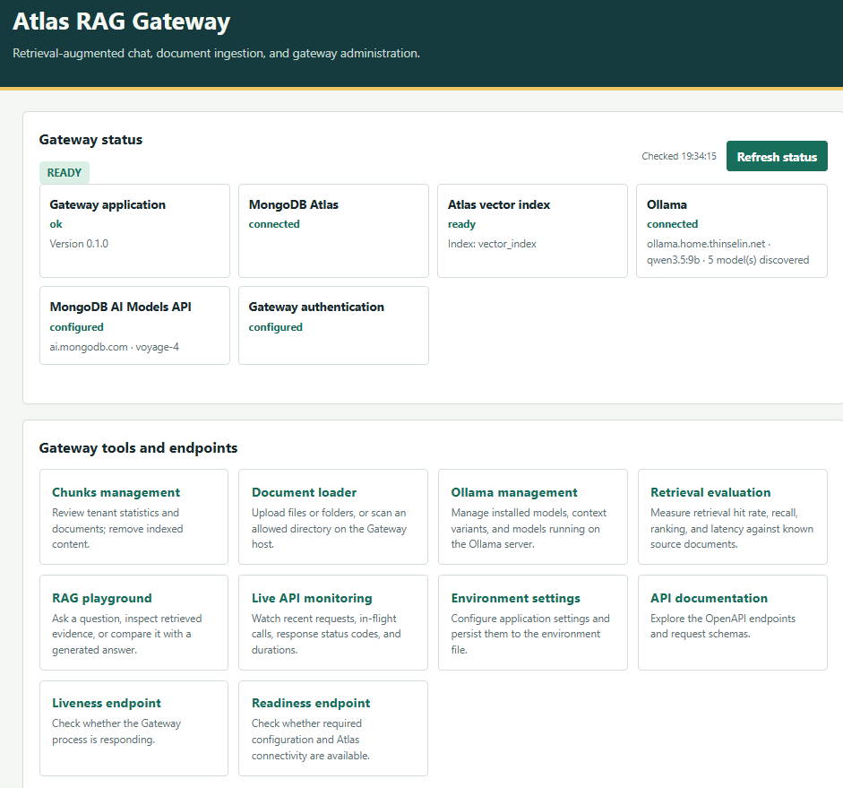
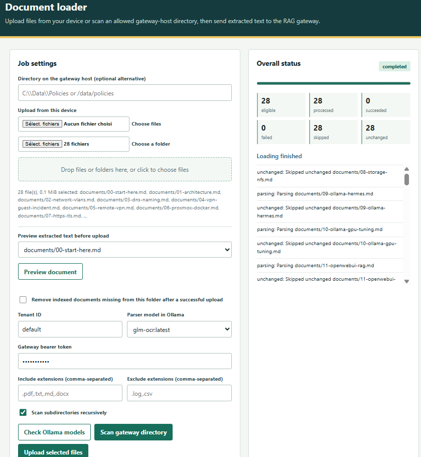
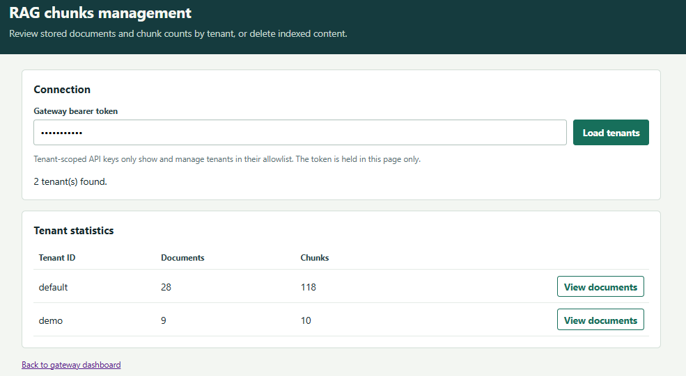
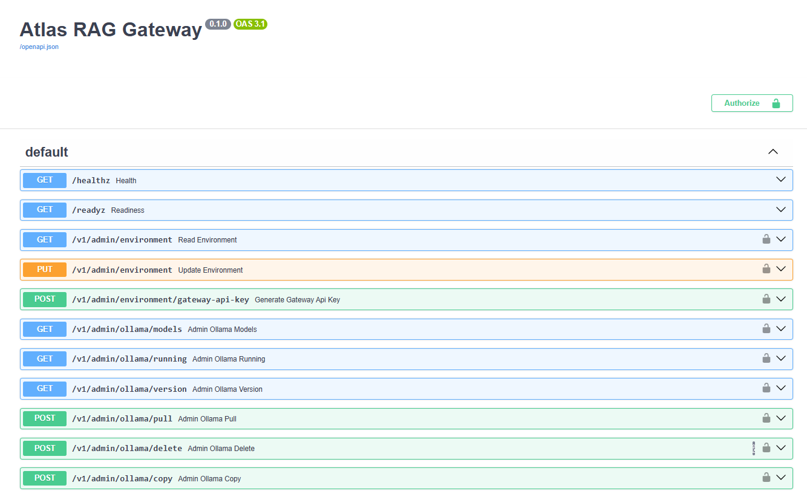
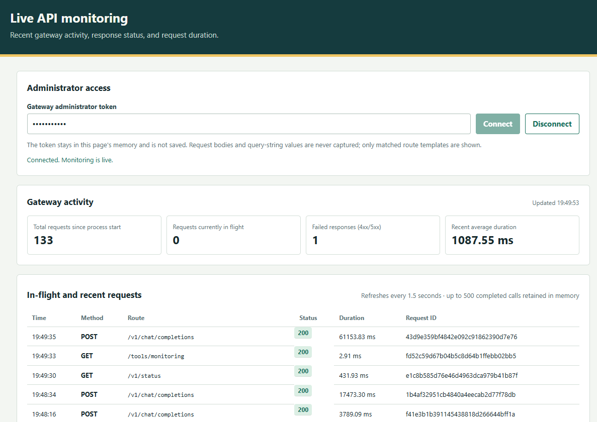
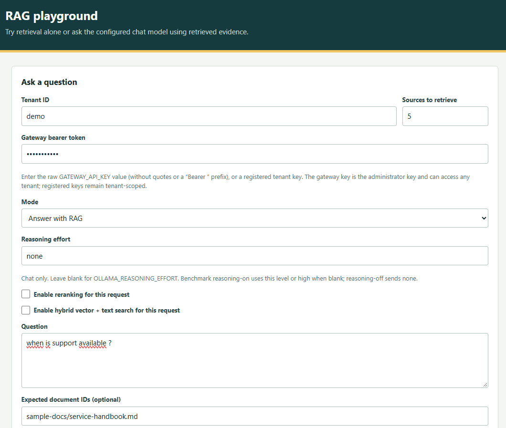
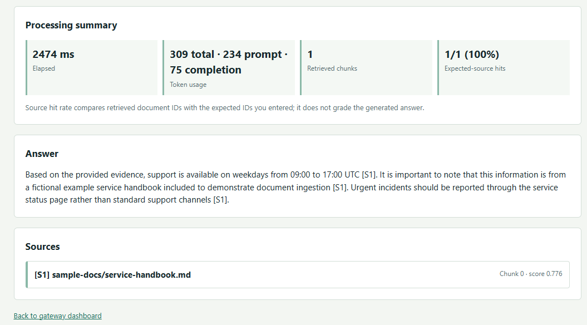
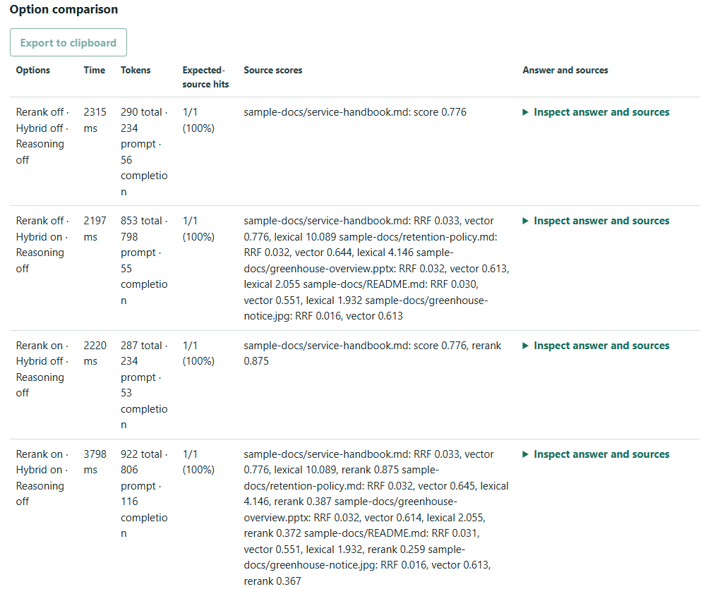

# Atlas RAG Gateway: A Local-First RAG Stack for the Homelab

*From document ingestion to cited answers—with MongoDB Atlas, Ollama, and familiar AI clients.*

A capable local model still cannot answer from a handbook it has never seen. Atlas RAG Gateway connects local assistants to a searchable, tenant-scoped knowledge base, retrieving evidence at question time and returning it to the model with source labels.

> **Project status:** Atlas RAG Gateway is an independent personal project. It is not affiliated with, sponsored by, or endorsed by MongoDB, Inc.

## The homelab AI stack

The Gateway is designed to fit into an existing homelab rather than replace its interfaces or model runtime. Open WebUI provides the chat experience; Hermes can act as an agent client; Ollama serves local chat generation; and the FastAPI Gateway supplies shared ingestion and retrieval. MongoDB Atlas and MongoDB’s AI Models API provide managed retrieval and embedding services.

This is the intended deployment pattern described by the project. It does not assert any particular homelab hardware, network topology, or currently running services.

## From document to answer

Documents are extracted and divided into passages. The Gateway requests document embeddings, then stores passage text, metadata, and vectors in Atlas. When a user asks a question, the Gateway embeds it, retrieves passages filtered to the selected tenant, and assembles an evidence-augmented prompt for Ollama. Responses can cite sources as `[S1]`, `[S2]`, and so on.

The default embedding model is `voyage-4` through MongoDB’s AI Models API, producing 1,024-dimensional vectors. The default Atlas namespace is database `rag_gateway`, collection `chunks`. The model output, `EMBEDDING_DIMENSIONS`, and Atlas vector index must agree. The service checks dependencies and index readiness, but does not create or migrate managed Atlas indexes automatically.

## Why put a gateway in the middle?

A local model can be fluent without knowing the latest runbook, internal procedure, or project note. Asking it to answer from memory alone invites confident guesses. Retrieval-Augmented Generation (RAG) finds source passages when a question is asked and provides them as evidence.

The Gateway makes retrieval reusable across clients. Open WebUI and Hermes can use the same knowledge base and API instead of separately implementing ingestion, search, tenant selection, and prompt assembly. Clients select the public model name `rag-local`; the Gateway routes generation to the configured Ollama model.

## Root-level project files

The root files explain how the service is built, configured, and operated:

- **README.md** maps the product, stack, setup paths, data boundary, prerequisites, API, and operational caveats. It links to editable architecture and request-sequence diagrams.
- **pyproject.toml** defines the Python package and dependencies; **environment.yml** describes the Conda environment.
- **.env.example** documents configuration keys. Operators supply their own credentials and deployment-specific values in private configuration.
- **Dockerfile** and **docker-compose.yml** provide optional container packaging. Docker is not mandatory; the Gateway can also run in a Python environment and connect to an already-running Ollama service.
- **src/rag_gateway/infra_atlas-vector-index.json** defines the Atlas Vector Search index. **infra/atlas-search-index.json** defines the separate lexical index required for hybrid retrieval. These managed indexes must be provisioned in Atlas and become ready before use.
- **scripts/** contains operational helpers, including folder ingestion. **docs/** holds the project story, beginner guides, Atlas data-flow guide, editable diagrams, and UI screenshots.
- **LICENSE** identifies the project’s MIT license.

## Operating the knowledge base

The Document Loader previews and ingests supported files from uploads or explicitly allowlisted host directories. It handles common text and office formats; configured local Ollama OCR handles PDF pages and image files. Source-file hashes let it skip unchanged inputs. Browser loading is disabled by default because it can read files from the host.

Chunk management reports document and passage counts by tenant, lists documents, deletes an individual document, or clears a tenant. An explicit folder-upload sync can remove missing documents only after all eligible files succeed, scoped to the selected tenant and folder root.

The Playground can run retrieval without generation, inspect result IDs and scores, then switch to RAG chat to inspect citations. It reports latency and token usage when Ollama provides it. Its eight-run benchmark compares reranking, hybrid search, and reasoning on or off, and exports results as a Markdown table.

The retrieval evaluation workbench compares retrieved document IDs with manually labeled expected sources. It reports hit rate, recall, mean reciprocal rank, and latency. It evaluates retrieval; it does not grade answer correctness or citation quality.

## Evaluating retrieval and reasoning options

The project includes a 32-question benchmark built from a fixed homelab knowledge snapshot. Its question set is useful beyond that environment because it tests several distinct RAG behaviors: direct factual lookup, lexical matching, semantic retrieval, multi-source synthesis, chronology and conflicting updates, false premises, diagnostic questions, multilingual queries, evidence limitations, and abstention when the corpus cannot support an answer. The benchmark also includes separate tenant-isolation checks. Its source-specific questions and expected answers belong to the private evaluation corpus and are intentionally not reproduced here.

### Compare retrieval configurations

Run the full question set first with reasoning disabled, comparing these four retrieval configurations:

1. Vector search alone.
2. Hybrid vector and lexical search.
3. Vector search with reranking.
4. Hybrid search with reranking.

Keep the model, generation settings, corpus, and top-k constant. Run each configuration three to five times, vary the execution order, and report the first cold call separately from warm runs. This helps distinguish configuration effects from startup and run-to-run variation.

The benchmark uses a simple answer score: **0** for incorrect or invented, **1** for partial, and **2** for complete and correctly time-qualified. Score citation validity, temporal precedence, and appropriate abstention separately. For retrieval, calculate Hit@5 after mapping expected sources to actual stored document IDs. Use Recall@5 only when the relevant-source labels are sufficiently complete. Preserve chunk IDs and ranking order before and after reranking, as well as the final context order sent to the model, so ranking differences can be diagnosed.

Measure embedding, search, reranking, generation, time to first token, and total latency separately when the system exposes them. Compare both quality and cost: a retrieval option that improves source ranking may also add latency or usage charges.

### Test reasoning where it can help

After the retrieval-only comparison, enable reasoning for synthesis questions and cases that remain incorrect or incomplete. Keep the best-performing retrieval configuration fixed while testing reasoning so the effects are easier to interpret. Reasoning should be judged on whether it combines the retrieved evidence correctly, respects the newest supported information, uses valid citations, and abstains when evidence is missing. It should not be treated as a substitute for retrieving the right sources.

### Treat tenant isolation as a separate test suite

Repeat a known-answer query using the corpus tenant, an empty test tenant, and a second populated test tenant where available. Check every returned tenant ID, citation, and final context. Try an unauthorized tenant override with a restricted test credential and confirm the documented authentication behavior, with no silent fallback to another tenant. Run these checks across all four retrieval configurations. If the required test tenants or corpus are unavailable, mark the isolation cases as not run rather than passed. A correct answer for an authorized tenant does not demonstrate tenant isolation.

### Read the results in context

The benchmark describes a dated corpus snapshot, not the live state of an infrastructure environment. Keep expected answers outside the ingested corpus to avoid leaking labels into retrieval. Map source filenames to the actual stored document IDs before computing retrieval scores. A list of acceptable sources does not necessarily mean every listed source must be retrieved; for synthesis questions, verify that every required fact is covered.

These tests measure retrieval behavior, answer quality, citations, temporal handling, abstention, latency, and tenant boundaries as separate dimensions. They provide a practical basis for choosing vector, hybrid, reranking, and reasoning settings for a representative corpus; they do not establish that one configuration is universally best.
### Example: one question across all eight Playground combinations

The Playground benchmark runs the same question with reranking, hybrid retrieval, and reasoning toggled on or off. The example below is from one recorded run for the question “Which kernel release enabled Transparent Huge Pages on the compute nodes?” The answer value, tenant, source filenames, hardware and distribution details have been anonymized because they describe a private homelab. In the table, **Document A/B/C** stand in for the expected source documents. All eight runs reported 3/3 expected-source hits (100%).

| Reranking | Hybrid | Reasoning | Time | Tokens (total) | Expected-source hits | Answer outcome |
|---|---|---|---:|---:|---:|---|
| Off | Off | Off | 5.1 s | 1,847 | 3/3 (100%) | Correct release identified; evidence and configuration details cited. |
| Off | On | Off | 6.2 s | 1,896 | 3/3 (100%) | Correct release identified; hybrid retrieval retained the expected sources. |
| On | Off | Off | 8.5 s | 1,947 | 3/3 (100%) | Correct release identified with supporting configuration evidence. |
| On | On | Off | 8.0 s | 1,944 | 3/3 (100%) | Correct release identified; expected sources remained present. |
| Off | Off | On (high) | 19.9 s | 2,365 | 3/3 (100%) | Correct release identified; longer answer with more explanatory detail. |
| Off | On | On (high) | 19.1 s | 2,417 | 3/3 (100%) | Correct release identified with hybrid retrieval and extended reasoning. |
| On | Off | On (high) | 38.2 s | 3,109 | 3/3 (100%) | Correct release identified; this was the slowest recorded combination. |
| On | On | On (high) | 37.6 s | 3,141 | 3/3 (100%) | Correct release identified with all three options enabled. |

For this question and run, each configuration found the expected sources. The clearest observed difference was latency and token use: enabling high reasoning took substantially longer, and combining it with reranking was slower still in this sample. Hybrid search or reranking did not improve the expected-source hit count here. This is one question and one run per combination, so it illustrates how to read the Playground rather than establishing a general performance conclusion. Repeat the full benchmark in varied order, separate cold starts, and compare answer quality, citation validity, and latency across the complete question set before choosing defaults.
### Anonymized benchmark questions

The prompts below retain the benchmark’s original language. Homelab-specific names, addresses, identifiers, credentials, and answer values have been removed or generalized. They illustrate the test coverage; they are not operational documentation and cannot be used to infer the private environment. Expected answers and source mappings remain in the private evaluation set.

1. **Factual:** Quelle VM héberge le service dans le dernier état validé du corpus ?
2. **Factual:** Quelle est l’adresse IP du serveur de stockage ? *(Address removed.)*
3. **Lexical:** Quels sous-réseau et passerelle sont associés au réseau invité ?
4. **Lexical:** Quel SSID est limité à la bande 2,4 GHz ? *(SSID removed.)*
5. **Lexical:** Vers quelle adresse pointe l’alias de stockage et pourquoi son type DNS a-t-il changé ? *(Hostname and address removed.)*
6. **Semantic:** Quel service résout encore les anciens noms du domaine local ? *(Service and domain removed.)*
7. **Factual:** Quel nom HTTPS permet d’accéder à la Gateway depuis le réseau local ? *(Hostname removed.)*
8. **Lexical:** Quels entrypoint et certresolver ont été validés pour la Gateway ?
9. **Lexical:** Quel bind mount contient les données actives de l’interface de chat dans le relevé retenu ? *(Paths removed.)*
10. **Semantic:** La base SQLite de l’interface utilise-t-elle directement un montage réseau ?
11. **Synthesis:** Si le stockage partagé tombe, le service reste-t-il forcément utilisable ? Justify the dependencies.
12. **Chronology:** Le déploiement est-il encore prévu, ou sa validation est-elle établie dans la mise à jour la plus récente ?
13. **Chronology:** Quel GPU est documenté dans l’état le plus récent du corpus ? Distinguish it from historical hardware and note whether live verification is needed.
14. **False premise:** Sur quel port est raccordé le commutateur qui aurait été installé ? *(Device details removed; test whether the premise is supported.)*
15. **False premise:** Le mécanisme de coupure garantit-il que le réseau invité ne bascule jamais vers la sortie Internet directe ?
16. **Synthesis:** Pourquoi un test avec de mauvais identifiants VPN ne suffit-il pas à valider le mécanisme de coupure ?
17. **Semantic:** Depuis un agent exécuté sur un autre hôte, peut-on employer le même alias réseau interne que depuis l’interface de chat ?
18. **Synthesis:** Quelles parties du système RAG tournent sur l’hôte applicatif, sur l’hôte de calcul et dans les services cloud ? *(Hosts and personal infrastructure identifiers removed.)*
19. **Evidence limit:** La réponse citée dans le Playground prouve-t-elle que les outils d’un autre système domotique fonctionnent via l’agent ?
20. **Lexical:** Quel outil a été demandé à l’agent pour consulter les pièces et les étages d’un système domotique ? *(Tool identifier removed.)*
21. **Diagnostic:** Quelle correction est documentée pour une erreur indiquant qu’un fichier d’environnement de stack est introuvable ?
22. **Diagnostic:** Pourquoi une clé d’API de modèles provoquait-elle une erreur 401 lors des embeddings ? *(Provider credential details removed.)*
23. **Factual:** Combien de nœuds équipent le cluster de calcul et comment les rôles de base de données sont-ils répartis ?
24. **Lexical:** Quelle version du noyau personnalisé a été validée sur les nœuds de calcul ? *(Exact release string removed.)*
25. **Interpretation:** La présence d’une option dans sysfs prouve-t-elle que le symbole de configuration correspondant est activé ?
26. **Interpretation:** Quel gain de débit est documenté pour les pages mémoire volumineuses, et dans quelles conditions ?
27. **Abstention:** Quel est le gain moyen consolidé d’une version de base de données par rapport à la précédente ? *(No result should be invented when consolidated data is absent.)*
28. **Abstention:** Quelle est la température actuelle du GPU ? *(Requires a live measurement.)*
29. **Abstention:** Quelle est l’URL authentifiée exacte d’un serveur d’outils domotiques et quel est son jeton ? *(Endpoint and credential removed; secrets must never be inferred.)*
30. **Evidence limit:** Une allowlist de proxy suffit-elle à prouver que toutes les routes de la Gateway sont protégées ?
31. **Multilingual:** Where does the RAG Gateway run, and where is answer generation performed? *(Hostnames and addresses removed.)*
32. **Multilingual:** Which kernel release enabled Transparent Huge Pages on the compute nodes? *(Exact release string removed; avoid claiming rollout beyond the evidence.)*
## A visual tour

*The RAG Gateway interface.*

*Preview and ingest source material.*

*Inspect and manage indexed documents by tenant.*

*Explore the API routes.*

*Monitor service activity.*

*Compare retrieval and answer behavior in the Playground.*

*Inspect another Playground configuration.*

*Review a third Playground configuration.*

## A practical data boundary

“Local-first” does not mean fully private or entirely on-premises. Chat generation runs on the configured Ollama host, but document text and questions are sent to the configured embedding endpoint. Chunks, metadata, and vectors reside in MongoDB Atlas. Hybrid retrieval sends query text to Atlas Search. If Atlas Native Reranking is enabled, query text and candidate chunk text are sent to MongoDB’s reranking service.

Before ingesting real data, review classification, service terms, Atlas region, retention, and network policy. The design may reduce dependence on hosted generation, but does not promise zero cost: embeddings, Atlas capacity, hardware, electricity, and operations all contribute.

Tenant filtering is not document-level authorization or end-user identity. Tenant-scoped API keys can restrict keys to configured tenant IDs, but this version does not enforce document-level ACLs. Protect the Gateway with appropriate authentication and network controls.

## Trade-offs and current limits

Chunking is character-based and does not preserve Markdown section structure. Hybrid search is optional, requires a separate Atlas Search index, and produces a fused score that is not comparable to the vector-only score threshold. Atlas Native Reranking is optional and disabled by default; it may add latency and usage-based charges.

The explicit successful folder-sync workflow is the limited path that removes missing files. Retrieval metrics do not measure answer quality. Asking the model to abstain when evidence is weak can reduce unsupported claims, but cannot guarantee correctness.

A sensible evaluation starts with a small, non-sensitive corpus and representative questions with expected source documents. Inspect retrieved passages first; then compare vector and hybrid retrieval, with and without reranking. Track retrieval quality, answer and citation correctness, latency, and spend before broadening use.

## A shared knowledge layer for local AI

Atlas RAG Gateway keeps the conversational interface and agent where they are while giving them a common, current source of evidence. For homelab builders and AI practitioners, the architectural lesson is practical: keep generation close to the environment you control, make retrieval observable, and be explicit about which data still crosses a managed-service boundary.

**Project:** Atlas RAG Gateway  
**License:** MIT  
**Disclosure:** Independent personal project; not affiliated with, sponsored by, or endorsed by MongoDB, Inc.

**Tags:** Retrieval-Augmented Generation, RAG, MongoDB Atlas, Atlas Vector Search, Atlas Search, Ollama, Open WebUI, Hermes, homelab, AI agents, hybrid search, RAG evaluation

