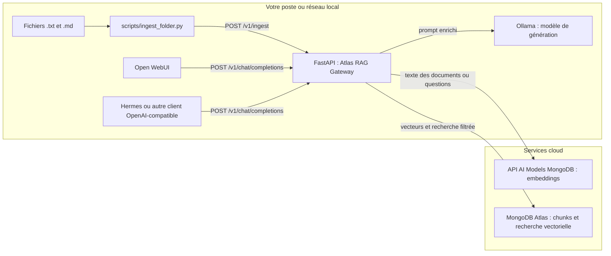
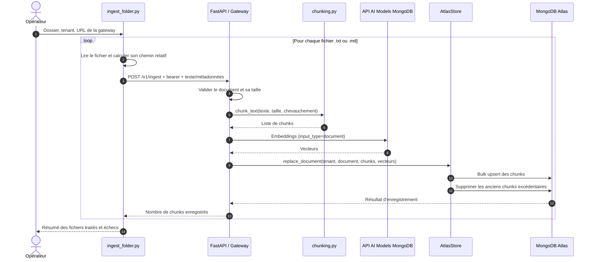
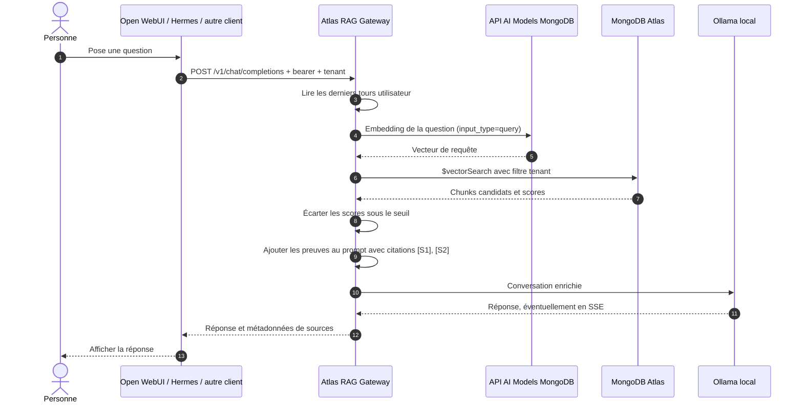

# Guide de débutant : Atlas RAG Gateway

Ce document explique comment l'application transforme des documents en réponses avec sources, où se trouvent les principales responsabilités dans le code et comment un client comme Open WebUI ou Hermes l'utilise.

## 1. Les fondamentaux

### RAG : rechercher avant de répondre

Un modèle de langage répond à partir de ce qu'il a appris pendant son entraînement et du texte reçu dans sa conversation. Il ne connaît pas automatiquement les documents privés de votre organisation et peut produire une réponse plausible mais inexacte.

Le RAG, pour *Retrieval-Augmented Generation*, ajoute une étape de recherche avant la génération :

1. Transformer la question en représentation de recherche.
2. Retrouver des passages pertinents dans un corpus de documents.
3. Ajouter ces passages à la conversation comme éléments de preuve.
4. Demander au modèle de répondre à partir de ces éléments, et de signaler si les preuves manquent.

La gateway orchestre cette séquence. Le modèle local génère la réponse ; MongoDB Atlas retrouve les passages ; l'API AI Models de MongoDB transforme les textes en vecteurs de recherche.

### Embedding : représenter le sens par un vecteur

Un embedding est une liste de nombres calculée à partir d'un texte. Des textes dont le sens est proche ont tendance à produire des vecteurs proches. On peut alors chercher des passages liés à une question, même si les mots ne sont pas exactement les mêmes.

Par défaut, cette application demande le modèle d'embedding `voyage-3.5` via l'API AI Models de MongoDB pour produire des vecteurs de 1024 dimensions. Le même modèle sert pour les documents et les questions, avec des modes distincts (`document` et `query`). Le nombre de dimensions du modèle, la configuration `EMBEDDING_DIMENSIONS` et l'index Atlas doivent correspondre.

La recherche est une proximité vectorielle avec similarité cosinus. Atlas renvoie un score ; l'application écarte les résultats en dessous de `RETRIEVAL_MIN_SCORE`, qui vaut `0.72` par défaut. Ce seuil est un point de départ à mesurer sur vos propres questions, pas une garantie universelle de pertinence.

### Chunking : découper un document en passages

Un document entier est souvent trop long pour être envoyé comme un seul résultat de recherche. Le *chunking* le découpe en passages plus courts, que l'on peut retrouver séparément.

Le code actuel normalise les espaces et retours à la ligne, découpe le texte en blocs d'environ `CHUNK_SIZE` caractères et conserve un chevauchement de `CHUNK_OVERLAP` caractères entre blocs voisins. Le chevauchement réduit le risque de couper une idée exactement à sa frontière.

Le découpage est basé sur les caractères, pas sur les tokens du modèle. Il ne conserve pas encore la structure Markdown des titres, tableaux ou sections.

### Reranking : réordonner les résultats

La recherche vectorielle sélectionne des passages candidats. Un *reranker* est une étape supplémentaire qui examine la question et chaque passage ensemble, puis les réordonne selon leur pertinence plus précise.

Le reranking peut améliorer les premiers résultats, mais ajoute généralement un appel modèle, de la latence et un coût. **Cette application ne fait pas de reranking aujourd'hui.** Elle conserve l'ordre de la recherche vectorielle Atlas et applique seulement son seuil minimal de score. La recherche hybride texte + vecteurs n'est pas implémentée non plus.

## 2. Vue d'ensemble

Le système comporte une partie locale et des services cloud. Les textes envoyés au point d'accès du modèle AI MongoDB pour créer les embeddings et les chunks/vecteurs stockés dans Atlas quittent donc l'environnement local. La génération de la réponse reste sur le service Ollama configuré.



## 3. Structure du code

Le code applicatif se trouve dans `src/rag_gateway/`. Chaque module a une responsabilité principale.

| Fichier | Responsabilité |
| --- | --- |
| [main.py](../src/rag_gateway/main.py) | Démarre FastAPI, vérifie l'authentification, expose les routes HTTP et coordonne ingestion, recherche et génération. |
| [config.py](../src/rag_gateway/config.py) | Lit les paramètres d'environnement et vérifie certaines valeurs, comme la taille et le chevauchement des chunks. |
| [models.py](../src/rag_gateway/models.py) | Définit les données attendues par l'API d'ingestion et sa réponse. |
| [chunking.py](../src/rag_gateway/chunking.py) | Découpe le texte en chunks avec chevauchement. |
| [voyage.py](../src/rag_gateway/voyage.py) | Appelle le point d'accès du modèle AI MongoDB configuré, groupe les textes en lots et réessaie certaines erreurs temporaires. |
| [store.py](../src/rag_gateway/store.py) | Écrit, remplace, supprime et recherche les chunks dans MongoDB Atlas. |
| [rag.py](../src/rag_gateway/rag.py) | Construit l'embedding de question, assemble les sources dans le prompt et extrait la requête depuis l'historique de chat. |
| [document_loader.py](../src/rag_gateway/document_loader.py) | Parcourt des dossiers, extrait plusieurs formats, appelle le modèle OCR Ollama configuré pour les pages/images et transmet la progression. |
| [scripts/ingest_folder.py](../scripts/ingest_folder.py) | Parcourt un dossier local et envoie les fichiers texte/Markdown à l'API. |
| [scripts/document_loader.py](../scripts/document_loader.py) | Interface CLI du chargeur multi-format Ollama. |
| [infra/atlas-vector-index.json](../infra/atlas-vector-index.json) | Exemple de définition de l'index Vector Search à créer dans Atlas. |
| [compose.yaml](../compose.yaml) | Décrit le lancement optionnel de la gateway dans Docker Compose. |

### Routes HTTP principales

Les routes `/v1/*` demandent un bearer token. Avec `API_KEY_REGISTRY` vide, il doit correspondre à `GATEWAY_API_KEY`. Si le registre est configuré, la clé doit être inscrite et associée au tenant demandé.

| Route | Utilité |
| --- | --- |
| `GET /v1/models` | Annonce le nom de modèle exposé par la gateway, par défaut `rag-local`. |
| `POST /v1/ingest` | Reçoit un document, le découpe, crée ses embeddings et enregistre ses chunks. |
| `DELETE /v1/documents/{document_id}` | Supprime un document pour le tenant sélectionné. |
| `POST /v1/retrieve` | Recherche et retourne les passages correspondant à une question, sans génération de réponse. |
| `POST /v1/chat/completions` | Effectue la recherche, enrichit la conversation et transmet la demande à Ollama. |
| `GET /healthz` et `GET /readyz` | Vérifient respectivement que le processus répond et que les dépendances/configurations essentielles sont disponibles. |

## 4. Comment un document est ingéré

L'ingestion prépare les données pour les futures recherches. Elle ne demande pas encore au modèle de chat de rédiger une réponse. Le script historique `scripts/ingest_folder.py` prend seulement les fichiers UTF-8 `.txt` et `.md`.

1. `scripts/ingest_folder.py` parcourt récursivement le dossier et sélectionne les fichiers `.txt` et `.md` encodés en UTF-8.
2. Pour chaque fichier, le script envoie son texte, son chemin relatif comme `document_id`, un `tenant_id` et des métadonnées à `POST /v1/ingest`.
3. FastAPI valide le corps de la requête, vérifie la limite `MAX_DOCUMENT_CHARS`, puis demande au module de chunking de découper le texte.
4. `VoyageEmbedder` envoie les chunks au point d'accès du modèle AI MongoDB configuré avec `input_type=document`. Les requêtes sont limitées par `EMBEDDING_BATCH_SIZE` et un budget de tokens estimé ; les erreurs temporaires sélectionnées font l'objet de tentatives avec délai progressif.
5. `AtlasStore` enregistre chaque chunk avec son vecteur, son tenant, son document, son numéro d'ordre, ses métadonnées, le modèle et la dimension d'embedding, la politique de chunking et un hash SHA-256 du texte.



Les identifiants de chunks sont déterministes pour un tenant, un document et un numéro de chunk. Réingérer un fichier remplace ses chunks et supprime ceux qui dépassent si le nouveau document est plus court. En revanche, le script ne synchronise pas les suppressions de fichiers : si un fichier disparaît du dossier, son document reste dans Atlas jusqu'à une suppression explicite.

Une ingestion directe est aussi possible en appelant `POST /v1/ingest` avec un corps JSON contenant `tenant_id`, `document_id`, `text` et éventuellement `metadata`.

### Chargeur multi-format Ollama

Le chargeur partage le moteur `document_loader.py` entre un CLI et l'interface web locale. Le modèle OCR par défaut est `glm-ocr:latest` : les pages PDF sont rendues en images et envoyées via l'API locale d'Ollama ; les images PNG, JPEG, TIFF et BMP suivent le même chemin. Les formats texte, CSV, HTML, JSON, XML/YAML, DOCX, XLSX/XLSM et PPTX utilisent des extracteurs locaux. Pour DOCX et PPTX, les textes et tableaux sont lus, mais les images incorporées ne sont pas analysées par cette version. Lorsque le chargeur web est activé, l'application journalise les modèles détectés par Ollama au démarrage.

Installez les bibliothèques optionnelles et vérifiez que le modèle configuré est disponible dans Ollama :

```bash
python -m pip install -e ".[dev,loader]"
```

La fiche NVIDIA documente Transformers et vLLM, pas une distribution officielle Ollama. Utilisez un paquet/build Ollama local compatible et vérifiez qu'il accepte des requêtes image avant de traiter un grand corpus. Le chargeur vérifie que le tag configuré apparaît dans la liste des modèles Ollama, mais sa présence ne garantit pas à elle seule la compatibilité de l'architecture.

Exemple CLI, avec inclusion et exclusion explicites :

```bash
export GATEWAY_API_KEY="your-local-key"
python scripts/document_loader.py ./sample-docs --tenant default \
    --include .pdf,.txt,.md,.docx,.xlsx,.pptx,.csv,.html \
    --exclude .log
```

La recherche est récursive par défaut. Le CLI affiche l'étape et le nom du fichier courant, continue après un échec individuel et termine avec un bilan général.

Pour l'interface web, autorisez explicitement les dossiers lisibles depuis l'hôte de la gateway. La fonction est désactivée par défaut, car elle donne accès à des fichiers locaux :

```dotenv
DOCUMENT_LOADER_ENABLED=true
DOCUMENT_LOADER_ROOTS=["/data/policies","/data/handbooks"]
DOCUMENT_PARSER_MODEL=glm-ocr:latest
```

Après redémarrage du service, ouvrez `http://127.0.0.1:8000/tools/document-loader`, saisissez un bearer token, sélectionnez les types et lancez le job. La page affiche le fichier courant, les compteurs éligibles/traités/réussis/en échec, les fichiers ignorés et les événements récents. Les jobs et leur historique sont conservés en mémoire uniquement ; un redémarrage les efface. L'accès web est limité aux chemins de `DOCUMENT_LOADER_ROOTS` et aux tenants autorisés par la clé. Un fichier source est limité à 50 MiB et le texte extrait doit respecter `MAX_DOCUMENT_CHARS`.

## 5. Comment une question devient une réponse

Un utilisateur écrit dans Open WebUI ou envoie une demande depuis Hermes. Ces applications n'interrogent pas elles-mêmes Atlas : elles appellent la gateway, qui applique la même logique de recherche quel que soit le client.

1. Le client envoie une requête OpenAI-compatible à `POST /v1/chat/completions`, avec `messages`, un bearer token et éventuellement `X-Tenant-ID`.
2. La gateway extrait les trois derniers messages utilisateur non vides et les combine pour fournir un peu de contexte aux questions de suivi, par exemple « et pour les sauvegardes ? ».
3. La question combinée est envoyée au point d'accès du modèle AI MongoDB configuré avec `input_type=query` pour obtenir un vecteur.
4. Atlas recherche les chunks les plus proches dans le tenant autorisé. Le pipeline applique `RETRIEVAL_TOP_K`, puis garde les résultats dont le score est supérieur ou égal à `RETRIEVAL_MIN_SCORE`.
5. La gateway ajoute les extraits trouvés à un message système. Les sources sont identifiées `[S1]`, `[S2]`, etc. Les textes des documents sont des données non fiables : certains marqueurs de prompt et de citation sont neutralisés, et le bloc d'évidence utilise un délimiteur aléatoire.
6. La requête enrichie est envoyée à l'API de chat locale d'Ollama.
7. La réponse est renvoyée au client. En mode non-streaming, les sources sont dans le champ `sources` de la réponse. En streaming, elles apparaissent dans un premier événement SSE utilisant une extension non standard `sources` ; certains clients peuvent l'ignorer.



Quand aucune source ne dépasse le seuil, la gateway indique au modèle qu'aucune preuve pertinente n'a été retrouvée et lui demande de ne pas inventer de faits sourcés. Ce mécanisme réduit le risque d'hallucination, mais ne garantit pas à lui seul la justesse de chaque réponse.

## 6. Configurer Open WebUI et Hermes

Les deux clients doivent se connecter à la **gateway RAG**, et non directement à Ollama ou à l'API AI Models de MongoDB. La gateway recherche le contexte filtré par tenant dans Atlas, l'ajoute à la conversation, puis appelle Ollama.

### Avant la connexion

1. Démarrez la gateway et vérifiez qu'elle est prête avec `GET /readyz`.
2. Ingérez quelques documents de test avec le tenant souhaité. L'ingestion reçoit `tenant_id` dans le corps ; le chat sélectionne le même tenant avec `X-Tenant-ID`.
3. Vérifiez que la clé API est acceptée :

   ```bash
   curl -H "Authorization: Bearer VOTRE_CLE_GATEWAY" \
     http://127.0.0.1:8000/v1/models
   ```

4. Choisissez l'URL de gateway accessible depuis le client :
   - Client sur le même hôte : `http://localhost:8000/v1`
   - Open WebUI dans Docker et gateway sur l'hôte : `http://host.docker.internal:8000/v1` (le conteneur doit pouvoir résoudre et joindre l'hôte)
   - Les deux dans Docker sur le même réseau : utilisez le nom du service gateway, par exemple `http://rag-gateway:8000/v1`

Le client doit utiliser la clé bearer brute de la gateway. N'utilisez pas `MONGODB_API_KEY` ici : cette clé sert uniquement aux requêtes d'embedding de la gateway. Si `API_KEY_REGISTRY` n'est pas vide, choisissez une clé brute enregistrée et autorisée pour le tenant.

### Open WebUI

1. Ouvrez **Admin Panel → Settings → Connections** et ajoutez une connexion **OpenAI-compatible** (les libellés peuvent varier selon la version).
2. Renseignez l'**API Base URL** avec l'URL de la gateway, suffixe `/v1` inclus.
3. Renseignez l'**API key** avec la valeur brute de `GATEWAY_API_KEY`, ou avec la clé brute enregistrée si `API_KEY_REGISTRY` est utilisé. Ne préfixez pas la clé par `Bearer`.
4. Enregistrez la connexion, actualisez ou récupérez la liste des modèles, puis sélectionnez **`rag-local`**. C'est l'identifiant public de la gateway ; celle-ci transmet ensuite la génération à `OLLAMA_MODEL`.
5. Pour un tenant autre que celui par défaut, configurez l'envoi de `X-Tenant-ID: votre-tenant`. Si votre version d'Open WebUI ne permet pas de définir des headers personnalisés pour cette connexion, utilisez `DEFAULT_TENANT_ID` pour cette connexion ou un autre client permettant de définir ce header.
6. Posez une question dont la réponse se trouve dans les documents ingérés. Vérifiez les citations comme `[S1]`. Si le contexte attendu n'est pas utilisé, testez la même requête avec `curl` pour distinguer un problème client d'un problème de retrieval.

### Hermes

1. Ajoutez un fournisseur/modèle qui prend en charge une **URL de base d'API personnalisée compatible OpenAI**.
2. Configurez l'URL de base avec l'URL de gateway ci-dessus, suffixe `/v1` inclus, puis utilisez la clé brute partagée ou enregistrée de la gateway (sans préfixe `Bearer `).
3. Choisissez l'identifiant de modèle **`rag-local`**. Ne configurez pas Hermes pour appeler le modèle d'embedding : la gateway s'occupe des embeddings et de la recherche Atlas.
4. Si le fournisseur permet des headers personnalisés, ajoutez `X-Tenant-ID: votre-tenant` pour un tenant non défini par défaut. Avec `API_KEY_REGISTRY`, la clé choisie doit être autorisée pour ce tenant.
5. Si votre version de Hermes ou son fournisseur ne permet pas d'utiliser une URL OpenAI-compatible personnalisée, appelez `POST /v1/chat/completions` via son outil HTTP/API. Envoyez la clé dans `Authorization: Bearer ...`, le tenant dans `X-Tenant-ID` et un corps compatible OpenAI, par exemple :

   ```json
   {
     "model": "rag-local",
     "messages": [{"role": "user", "content": "Que dit le guide sur les congés ?"}],
     "stream": false
   }
   ```

Conservez la clé gateway dans le gestionnaire de secrets ou l'environnement du client, jamais dans les prompts, une configuration partagée ou le dépôt Git. En streaming, les métadonnées de source sont envoyées dans un événement SSE initial avec l'extension non standard `sources` ; le client peut afficher la réponse sans présenter ces métadonnées.

## 7. Configuration et limites à connaître

Les réglages se trouvent dans `.env` ; `.env.example` donne les noms et valeurs de départ. Le chargeur web est contrôlé par `DOCUMENT_LOADER_ENABLED`, `DOCUMENT_LOADER_ROOTS` et `DOCUMENT_LOADER_MAX_ACTIVE_JOBS`. `DOCUMENT_PARSER_MODEL` et `DOCUMENT_PARSER_TIMEOUT_SECONDS` règlent le parseur Ollama. Parmi les autres paramètres importants :

| Paramètre | Rôle |
| --- | --- |
| `MONGODB_URI`, `MONGODB_DATABASE`, `MONGODB_COLLECTION` | Connexion et emplacement des chunks dans Atlas. |
| `MONGODB_API_MODEL_ENDPOINT` | Nom d'hôte du service API Model de MongoDB ; valeur par défaut : `ai.mongodb.com`. |
| `MONGODB_API_KEY` | Requise pour les requêtes d'embedding ; elle sert aussi à la vérification du modèle au démarrage. |
| `ATLAS_VECTOR_INDEX` | Nom de l'index Vector Search déjà créé dans Atlas. |
| `MONGODB_API_KEY`, `VOYAGE_EMBEDDING_MODEL`, `EMBEDDING_DIMENSIONS` | Service MongoDB AI pour les embeddings et format des vecteurs. |
| `GATEWAY_API_KEY` ou `API_KEY_REGISTRY` | Authentification partagée ou autorisations statiques clé-vers-tenant. |
| `OLLAMA_BASE_URL`, `OLLAMA_MODEL` | Adresse et modèle de génération local. Compose remplace `OLLAMA_BASE_URL` dans le conteneur pour joindre l'hôte. |
| `CHUNK_SIZE`, `CHUNK_OVERLAP` | Découpage caractère des documents. |
| `EMBEDDING_BATCH_SIZE` | Nombre maximal de textes par requête au modèle AI MongoDB, avec budget de tokens estimé en plus. |
| `RETRIEVAL_TOP_K`, `RETRIEVAL_MIN_SCORE` | Nombre maximal de résultats et score minimal accepté. |

Les embeddings et le stockage sont des services cloud dans cette architecture : le texte source et les questions partent vers le point d'accès du modèle AI MongoDB configuré, et les chunks ainsi que leurs vecteurs résident dans Atlas. Vérifiez la classification des données et les règles de votre organisation avant d'utiliser des documents réels.

Au démarrage, la gateway journalise les modèles Ollama détectés et envoie un ping à Atlas sans exposer les identifiants de l'URI. Si `MONGODB_API_KEY` est configurée, elle envoie également une petite requête d'embedding au point d'accès MongoDB AI, susceptible de compter dans l'utilisation de l'API ; sinon, cette vérification est journalisée comme ignorée. L'ingestion des documents et l'embedding des requêtes utilisent le même point d'accès et la même clé.

L'application stocke des informations de provenance sur les embeddings et les chunks, mais ne sait pas encore effectuer une migration automatisée de modèle, ignorer les fichiers inchangés ni synchroniser la disparition de fichiers du dossier. Elle n'intègre pas non plus de reranker, de recherche hybride, de jeu d'évaluation, de métriques Prometheus ou de filtrage ACL au niveau document. Le seuil de score et les paramètres de chunking doivent être évalués avec des questions représentatives avant un déploiement large.

## 8. Démarrage rapide

Après avoir installé les dépendances et configuré `.env`, on peut démarrer l'API ainsi :

```bash
python -m uvicorn rag_gateway.main:app --host 127.0.0.1 --port 8000
```

Avant la première recherche, il faut que MongoDB Atlas soit accessible, que l'index Vector Search configuré soit à l'état `READY`, que `MONGODB_API_KEY` soit configurée et qu'Ollama serve le modèle de chat choisi. Pour les instructions d'installation par plateforme, voir le [README du projet](../README.md).

Les tests automatisés du dépôt se lancent avec :

```bash
python -m pytest -q
```