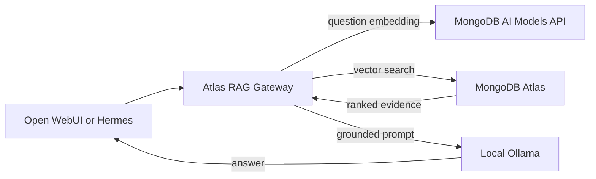
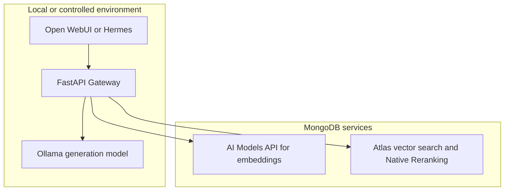

# Why Atlas RAG Gateway Exists

> **Project status:** Atlas RAG Gateway is an independent personal project. It is not affiliated with, sponsored by, or endorsed by MongoDB, Inc.

## The useful model is not enough

Running a language model locally is an important step toward autonomy. It gives a team control over the generation runtime, lets it choose a model that fits its hardware, and avoids sending every conversation to a hosted chat service. But a local model still does not know the current handbook, runbook, policy, or project notes sitting in a team's files. Asking it to answer from memory alone is a recipe for confident guesses.

The project began with a practical question: how can a local assistant use an organization's own knowledge without rebuilding every client or treating the model's training data as a document search system?

## Give the model evidence at question time

Atlas RAG Gateway puts retrieval between the client and the model. Documents are split into passages, embedded, and stored with their vectors and metadata. When a user asks a question, the gateway embeds that question, searches for nearby passages within the selected tenant, and adds the strongest qualifying passages to the conversation. Ollama then generates an answer using that evidence, with source labels such as `[S1]` and `[S2]`.

This is Retrieval-Augmented Generation: rather than expecting the model to remember private or changing material, retrieve relevant context when it is needed. The same gateway can serve Open WebUI, Hermes, and other compatible clients, so the retrieval behavior is shared instead of re-created in each interface or agent.

## A deliberate division of work

The design favors local control where it matters most to interactive use, while using managed services for retrieval infrastructure:

- **Local generation:** Ollama serves the chat model on the configured local or controlled host. Chat prompts and generated answers go to that service rather than to a hosted generation API.
- **Semantic embeddings:** the default `voyage-3.5` model, called through MongoDB's AI Models API, turns both passages and questions into 1024-dimensional vectors. This gives retrieval a purpose-built semantic representation rather than relying only on exact word matches.
- **Managed vector search:** MongoDB Atlas stores chunks, metadata, and vectors, and runs tenant-filtered nearest-neighbor search.
- **A compatible gateway:** FastAPI handles ingestion, retrieval, prompt assembly, authentication, and OpenAI/Ollama-compatible chat routes. Clients select the public model name `rag-local`; the gateway chooses the configured Ollama model behind it.

That split aims to make the system useful without paying for hosted generation on every answer, and to use a stronger semantic search representation to improve the context passed to the local model. It does not guarantee lower total cost: embedding requests, Atlas capacity, hardware, electricity, and operations all have costs. Nor is the design fully private or on-premises. Source text and questions are sent to the configured embedding service, and stored chunks and vectors reside in Atlas. Data classification, service terms, region, retention, and network policy must be checked before real data is used.

## Make the context inspectable

RAG quality depends on the passages found, not just on the model that writes the final response. The gateway therefore includes tools to inspect and operate the knowledge base:

- **Playground:** run retrieval without generating an answer, inspect document IDs, chunk text, and scores, or switch to RAG chat and inspect citations. This helps separate a retrieval problem from a generation problem.
- **Chunk management:** review document and chunk counts by tenant, list a tenant's documents, delete one document, or clear a tenant. Tenant-wide deletion asks for confirmation in the UI.
- **Document loader:** preview and ingest supported local files, browser uploads, or allowlisted host directories. Local extractors handle many text and office formats; configured Ollama OCR handles PDF pages and image files. The browser loader is disabled by default because it can read files from its host.
- **Retrieval evaluation:** compare retrieved document IDs with manually labeled expected documents. The workbench reports hit rate, recall, mean reciprocal rank, and latency. It evaluates retrieval, not answer correctness or citation quality.
- **Environment and status pages:** inspect dependency status and edit settings through an authenticated interface, with existing secret values redacted. A generated replacement gateway key is shown once and must be copied before saving.

These tools make it possible to test with a small corpus and known questions before relying on the gateway in a daily workflow. They also expose important operational boundaries: the browser loader needs explicit directory allowlists, tenant keys only scope access by tenant, and this version does not enforce document-level permissions.

## The goal is more relevant assistance

Open WebUI remains the conversational interface; Hermes remains the agent. The gateway does not try to replace either one or change their personalities. It gives them a shared, current, tenant-scoped evidence source, so their answers can be more relevant to the documents a user is allowed to query. If the evidence is missing or falls below the configured score threshold, the gateway asks the model not to invent source-backed facts. This reduces one failure mode, but it is not a correctness guarantee.

The project is intentionally transparent about what remains unfinished: chunking is character-based, hybrid search is not implemented, deleted source files are not synchronized automatically, and the evaluation tool does not score generated answers. MongoDB Native Reranking is enabled behind the scenes and handled by MongoDB after the Gateway submits vector-search candidates; the Gateway does not configure or call a reranker directly. This managed inference can add latency and usage-based charges, and MongoDB states that it runs on its infrastructure in a US region. The next improvements should be chosen using representative questions, inspected retrieval results, measured latency and cost, and the data policies of the environment where the gateway will run.